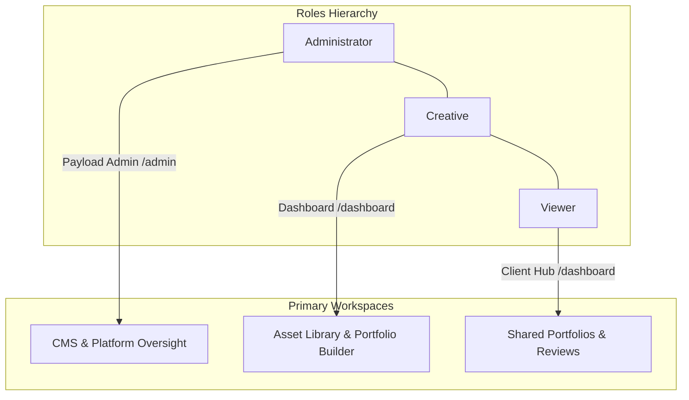

# FRH-65 — Enterprise User Roles, Journeys, and UX/UI Specification

## 1. Executive Summary

Framehouse Hub is a premium Digital Asset Management (DAM) and client presentation platform. To scale effectively in enterprise creative environments, the platform must clearly distinguish between three core user personas. This document details the product-centric specifications, UX/UI layouts, and user journeys for these roles:

1. **Administrators (Admins)**: Platform orchestrators who manage waitlists, page layouts, public resources, audit logs, and support operations (via Diagnostic Mirror Mode).
2. **Creatives**: The primary producers who ingest bulk media, organize assets into sessions/collections, build layout-driven portfolios, and manage client feedback loops.
3. **Viewers (Clients / Collaborators)**: Clients or guest stakeholders who securely access shared portfolios, leave frame-accurate reviews or comments, approve asset lists, and download approved deliverables without full workspace access.

This spec focuses on the **product behavior, layout morphing, and UX/UI flow** across Next.js and Payload CMS, highlighting the gaps between our current implementation and enterprise best practices.

---

## 2. Market Research & Platform Positioning

By analyzing world-renowned platforms (e.g., **Frame.io**, **Brandfolder**, **Pixieset**, and **Adobe Experience Manager**), we define the hierarchy and boundaries for Framehouse Hub:

*   **The Contributor vs. Consumer Boundary**: In professional workflows, consumers (clients/collaborators) must never see empty dashboards or complex metadata upload forms. Frame.io solves this by routing clients to clean review interfaces or a simplified "Shared with Me" inbox. Pixieset provides a client-facing gallery dashboard that segregates the photographer's builder from the client's selection dashboard.
*   **Support & Mirroring Transparency**: In enterprise SaaS, administrators require a secure, zero-credential way to troubleshoot user layouts. Like Salesforce's "Log in as User" or Brandfolder's admin delegation, this must be visually highlighted to prevent unauthorized actions and create immutable audit logs.
*   **CMS Content Control**: Public-facing learning centers (marketing blogs, tutorials, resource lists) are critical for SEO and onboarding. Admins require direct, WYSIWYG publishing power, while creatives and viewers consume this content in a distraction-free environment.

---

## 3. User Archetypes & Product Purpose



### 3.1 The Administrator (Platform Operations)
*   **Purpose**: Manages system configuration, public marketing, waitlists, pricing tiers, and troubleshoots creative client environments.
*   **Primary Surface**: Payload CMS Admin Panel (`/admin`) + Custom Oversight Tab + Diagnostic Mirror Mode (`/dashboard/diagnostic/[token]`).
*   **Value Metric**: Time-to-resolution for creative support tickets and publishing velocity for marketing/learning resources.

### 3.2 The Creative (Content Producer & Studio Owner)
*   **Purpose**: Bulk ingests assets, categorizes shoot sessions, generates smart rules, and builds themed client-sharing portfolios.
*   **Primary Surface**: Authenticated Creator Dashboard (`/dashboard`) + Account Cockpit (`/account`).
*   **Value Metric**: Asset upload speeds, portfolio presentation customization, and speed of client approvals.

### 3.3 The Viewer (Client & Collaborator)
*   **Purpose**: Accesses shared assets, collaborates on reviews, downloads final products, and maintains secure credentials.
*   **Primary Surface**: Simplified Client Portal (`/dashboard` for viewers) + Interactive Portfolio Review Stage (`/p/[slug]`).
*   **Value Metric**: Simplicity of the selection process, clarity of commenting tools, and secure, bookmark-free access to deliverables.

---

## 4. User Journeys

```
CREATIVE USER JOURNEY:
Ingest Media ──> Organize (Sessions/Smart Colls) ──> Design Portfolio ──> Share Link with Client
                                                                               │
                                                                               ▼
VIEWER USER JOURNEY:
Log in to Client Hub ──> View Shared Portfolios ──> Make Selections / Comment ──> Download Assets
                                                                               │
                                                                               ▼
ADMIN USER JOURNEY:
Monitor Activity Logs <── Troubleshooting Ticket <── Launch Read-Only Diagnostic Mirror Mode
```

### 4.1 Creative Journey — "Shoot to Delivery"
1.  **Ingestion Workbench**: Alex (Creative) logs in and sees their Library. They drag 150 raw photos into the upload area. The system assigns a unique `UploadBatchId` and `AccessionId` (e.g., `ACC-2026-0142`) to each asset.
2.  **Archival Organization**: Alex creates a Session named "Acme Q2 Campaign" and sets default tags (e.g., `acme`, `summer-2026`). The files are processed into WebP proxies via the Go worker.
3.  **Dynamic Filtering**: Alex sets up a Smart Collection using filter rules (e.g., `cameraModel == "Sony A7 IV"` and `status == "ready"`). The collection populates automatically.
4.  **Portfolio Layout Curation**: Alex launches the Portfolio Wizard (`/dashboard/portfolios/new`). They add layout blocks (a filmstrip section for hero products and a masonry grid for behind-the-scenes). They set the visibility to `shared` and establish a password.
5.  **Review Loop Monitoring**: Alex sends the link to the client. Later, they visit the Reviews page (`/dashboard/portfolios/[id]/reviews`) to see client-submitted lists and comments, clicking "Acknowledge" to finalize.

### 4.2 Viewer Journey — "Secure Collaborative Review"
1.  **Secure Authentication**: Sarah (Client) receives an invite to view her company's assets. She registers an account and lands on her **Client Hub** (`/dashboard`).
2.  **Centralized Inbox**: Sarah does not see an empty database. Instead, she is greeted by a **"Shared Portfolios"** dashboard showing the "Acme Q2 Campaign" portfolio. All creator-specific controls (e.g., upload button, portfolio wizard, storage limits) are hidden.
3.  **Review and Interaction**: Sarah opens the portfolio. She views high-resolution images in the lightbox, selects 12 assets she wants to approve, and leaves comments (e.g., "Adjust exposure on this product shot") directly on the cards.
4.  **Submission**: Sarah clicks "Submit Review," adding a client note: "These are approved for print."
5.  **Deliverable Retrieval**: Once Alex approves the comments, Sarah returns to the Client Hub and downloads a zipped archive of the approved original-quality assets directly from the portal.

### 4.3 Administrator Journey — "Content Management & Support"
1.  **Public Content Updates**: Marcus (Admin) drafts a new article explaining "Best EXIF workflows for raw files." He logs into `/admin`, writes the post in the `Articles` collection, uploads a hero image, and publishes it to the `/learn` hub.
2.  **Waitlist Ingestion**: Marcus reviews new waitlist submissions in `/admin/collections/waitlist` and promotes approved users by modifying their roles to `['creative']`.
3.  **Troubleshooting Escalation**: A creative user submits a support ticket: "My masonry layout in portfolio 'Wedding-2026' is crashing on mobile."
4.  **Oversight Diagnostic**: Marcus navigates to `Users` in the admin panel, clicks on the creative's profile, and selects the **Oversight Tab**. He reviews their storage metrics (e.g., 1.4 TB used) and locates the portfolio.
5.  **Diagnostic Mirror Launch**: Marcus clicks **"Launch Diagnostic Mirror"**. A read-only replica of the creative's dashboard opens at `/dashboard/diagnostic/[token]`. Marcus navigates to the wedding portfolio. A bright orange countdown banner confirms he is in Mirror Mode. All writes (mutations) are blocked.
6.  **Resolution**: Marcus identifies that the creative input a corrupt custom layout height. Marcus closes the mirror tab, returns to `/admin`, edits the portfolio's fields directly to reset the height, and resolves the ticket. The `AdminActivityLogs` collection records a permanent audit trail of Marcus's inspection and database correction.

---

## 5. Holistic Spec Design (UX/UI Gating)

### 5.1 Dashboard Layout Transformations
The Next.js Sidebar Navigation (`src/components/layout/DashboardLayout/Sidebar.tsx`) and TopBar dynamically adapt to the user's role:

```
+-----------------------------------------------------------------------+
|  HUB ARCHIVE                                           [User Avatar]  |
+-----------------------------------------------------------------------+
|                                                                       |
|  [CREATIVE & ADMIN VIEW]              [VIEWER (CLIENT) VIEW]          |
|                                                                       |
|  +---------------------+              +---------------------+         |
|  |  [+ Upload Media]   |              |                     |         |
|  |                     |              |                     |         |
|  |  LIBRARY            |              |  CLIENT PORTAL      |         |
|  |  o Archive          |              |  o Shared with Me   |         |
|  |  o Sessions         |              |  o Reviews & Feed   |         |
|  |  o Collections      |              |                     |         |
|  |                     |              |  SETTINGS           |         |
|  |  PUBLISH            |              |  o Account Security |         |
|  |  o Portfolios       |              |                     |         |
|  |  o Shared           |              |                     |         |
|  |                     |              |                     |         |
|  |  WORKSPACE          |              |                     |         |
|  |  o Archive Work     |              |                     |         |
|  |  o Account          |              |                     |         |
|  |                     |              |                     |         |
|  |  [Storage Meter]    |              |                     |         |
|  +---------------------+              +---------------------+         |
|                                                                       |
+-----------------------------------------------------------------------+
```

#### Detailed Layout Restraints

1.  **Sidebar Header Primary Action**:
    *   *Creative/Admin*: Displays the gold **"Upload Media"** button which launches the `UploadProvider` picker modal.
    *   *Viewer*: Hidden. Viewers cannot upload assets.
2.  **Navigation Links**:
    *   *Creative/Admin*: Full menu groups: `LIBRARY` (Archive, Sessions, Collections), `PUBLISH` (Portfolios, Shared), and `WORKSPACE` (Archive Work, Account).
    *   *Viewer*: Simplified navigation: `CLIENT PORTAL` (Shared with Me, My Reviews) and `WORKSPACE` (Account Settings).
3.  **Storage Progress Widget**:
    *   *Creative/Admin*: Displayed at the bottom of the sidebar, indicating current byte consumption against the 2 TB tier limit.
    *   *Viewer*: Hidden. Viewers do not consume storage limits.
4.  **TopBar Search Control**:
    *   *Creative/Admin*: Launches global index search across all owned assets.
    *   *Viewer*: Hides global search. If search is shown, it must only return metadata of files inside portfolios shared with them.

---

### 5.2 Interactive Feature Access Control Matrix

| Feature / UI Route | Admin | Creative | Viewer |
|---|---|---|---|
| **`/admin` Portal** | Full Access | Blocked (Redirected) | Blocked (Redirected) |
| **Media Upload / Ingestion** | Allowed | Allowed | Blocked (Hidden) |
| **Create/Edit Portfolios** | Full Access (via `/admin`) | Full Access (via `/dashboard`) | Read-Only View (`/p/[slug]`) |
| **Review Submission** | View Logs / Override | View & Acknowledge | Submit Selections & Comments |
| **Audit Logs & Diagnostics** | Full Access | Blocked (Hidden) | Blocked (Hidden) |
| **General Pages (`Pages`)** | Read / Write / Publish | Read-Only (Public Site) | Read-Only (Public Site) |
| **Resources (`Articles`, `Tutorials`, `Downloads`)** | Read / Write / Publish | Read-Only (Public Site) | Read-Only (Public Site) |

---

### 5.3 Account Cockpit UI Gating
To maintain a streamlined settings experience, the `/account` page dynamically locks groups based on roles:

```
ACCOUNT SETTINGS (DESKTOP VIEW)
+-----------------------+-------------------------------------------------+
|  o Profile Details    |  PROFILE DETAILS                                |
|  o Client Settings    |  Name: [ Sarah Jenkins ]                        |
|  o Security & Sessions|  Email: [ sarah.jenkins@acme.com ]              |
|                       |                                                 |
|                       |  CLIENT HUB DEFAULT THEME                       |
|                       |  [x] Light Mode  [ ] Dark Mode                  |
|                       |                                                 |
|                       |  (Branding Settings Hidden for Viewers)         |
|                       |                                                 |
+-----------------------+-------------------------------------------------+
```

1.  **Profile Details (Name, Email)**: Visible and editable for all roles.
2.  **Branding Identity (Studio Name, Bio, Studio Logo Crop)**:
    *   *Creative/Admin*: Visible. Allows custom styling.
    *   *Viewer*: Hidden completely.
3.  **Portfolio Defaults**:
    *   *Creative*: Visible. Configures default behavior for newly created portfolios.
    *   *Viewer*: Hidden completely.
4.  **Security (Password Change & Active Sessions)**: Visible for all roles. Viewers can also re-authenticate to change their password and revoke lingering sessions.

---

## 6. Gap Analysis & Existing Code Review

An audit of the codebase reveals several areas that are already aligned with this spec, alongside critical items that need to be addressed in the future:

### 6.1 Satisfied Requirements
1.  **Payload Role Definition**: The `Users` schema in `src/collections/Users/index.ts` already has the correct enum values (`admin`, `creative`, `viewer`) and defaults to `['viewer']` for new registrations.
2.  **Backend Security Fixes**:
    *   `src/access/creativeOrAdmin.ts` successfully restricts writes to `admin` and `creative` roles.
    *   `src/collections/Users/index.ts` gates `/admin` UI access exclusively to `admin` users (as patched in FRH-64).
3.  **Admin CMS Collections**: The `Pages`, `Articles`, `Downloads`, and `Tutorials` collections correctly enforce `adminOnly` writes, allowing administrators to update marketing and resource pages.
4.  **Admin Oversight & Diagnostic Banner**: The mirror framework and banner logic in `/dashboard/diagnostic/[token]` are fully implemented, providing read-only inspection boundaries.

### 6.2 The Gaps (What Must Be Implemented)
1.  **The Viewer Inbox ("Shared Portfolios")**:
    *   *Current Issue*: If a user with a `viewer` role logs in, their `/dashboard` redirects to `/dashboard/library` where they see a blank library and empty collections because they do not own any assets.
    *   *Required Fix*: Establish a path where viewers land on a **"Shared with Me"** client feed. This requires a query resolving portfolios where:
        1.  The portfolio is explicitly shared with their user ID (requires adding a `sharedWith` relationship on the Portfolios collection).
        2.  OR, the portfolio has received review submissions matching their authenticated email address.
2.  **Dynamic Sidebar Morphing**:
    *   *Current Issue*: The `Sidebar.tsx` currently hides the primary "Upload Media" button and the "Archive Work" navigation for non-creatives, but still displays the *LIBRARY* and *PUBLISH* links.
    *   *Required Fix*: Update `Sidebar.tsx` to completely swap the navigation tree when `!isCreative`, showing only the Client Hub links ("Shared Portfolios" and "My Reviews") instead of creator links.
3.  **Account Page Dynamic Cleanup**:
    *   *Current Issue*: The newly built `/account` page (from FRH-64) renders profile branding and portfolio defaults for all users.
    *   *Required Fix*: Gate the rendering of the `Profile Identity`, `Portfolio Defaults`, and `Cloud Storage` sections in `AccountSettingsShell.tsx` to only display when the authenticated user is a `creative` or `admin`.

---

## 7. Future Verification Plan

To verify the correct enforcement of role-based boundaries, the following tests will be implemented:

### 7.1 Automated Integration Rules
*   **Media Collection**:
    *   `POST /api/media` as a `viewer` -> Expect `403 Forbidden`.
    *   `POST /api/media` as a `creative` -> Expect `201 Created`.
*   **Portfolio Access**:
    *   `POST /api/portfolios` as a `viewer` -> Expect `403 Forbidden`.
*   **Oversight Tab**:
    *   `GET /api/admin/creative-metrics/[userId]` as a `viewer` -> Expect `401 Unauthorized` or `403 Forbidden`.

### 7.2 Manual Walkthrough Scenarios
1.  **Register a New User**: Ensure new registrations default to the `viewer` role. Upon logging in, verify that the sidebar lacks the "Upload Media" button, the storage meter, and creator links, displaying only the "Shared with Me" empty state page.
2.  **Share a Portfolio**: Create a portfolio as a Creative and add a viewer's email. Log in as that Viewer, verify that the portfolio appears in their Shared inbox, and verify that they can review, comment, and submit selections.
3.  **Verify Diagnostic Safeguards**: Log in as an Admin, inspect the viewer or creative, spin up Mirror Mode, and verify that all interactive inputs in the portfolio editor and media library are disabled and display read-only tooltips.
