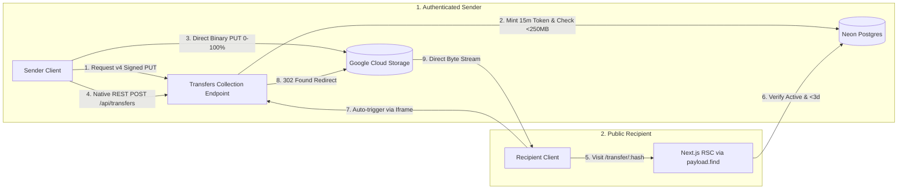

# FRH-67: Link Transfer Generation — Feature Design Specification

**Spec Version**: 3.0 (Simplified & Maximized Payload CMS Architecture)  
**Status**: Ready for Engineering & Manual Architecture Review  
**Branch Convention**: `FRH-67-Link-Transfer-Generation`  
**Base Branch**: `dev`  
**Author**: Platform Architecture Team  
**Date**: 2026-10-15  

---

## 1. Overview & Problem Statement

### 1.1 Executive Summary
Framehouse Hub currently provides digital asset management (DAM), archival ingestion, and client review presentation capabilities. Creatives frequently need an ad-hoc, low-friction mechanism to transfer standalone deliverables, proofs, or working files to clients and external collaborators without curating a permanent Portfolio or running files through the heavy archival DAM processing pipeline.

**FRH-67 (Link Transfer Generation)** introduces a lightweight, high-performance file transfer mechanism (analogous to WeTransfer) embedded directly into Framehouse Hub. Authenticated users can drag and drop a single file up to 250MB, generate a unique, public download URL with a single click, and automatically have that link copied to their clipboard for instant distribution. Recipients can open the link in any browser and download the exact original file instantly without requiring an account or logging in.

**Key Parameter Pinning**:
- **Max File Size**: **250MB** (Enforced at client dropzone, Payload field validation, and signed-URL gateway).
- **Default Expiration / Retention**: **3 Days (72 Hours)** (Optimized for free-tier storage economy).
- **Sender Scope**: **Active Account Users Only** (`creative` or `admin`). Anonymous uploads are formally out of scope for MVP.
- **Recipient Scope**: **Public / Anonymous** (Zero login, instant automated download dispatch).

### 1.2 Creative North Star & Philosophy
In alignment with `DESIGN.md` ("The Curated Gallery"), file transfer in Framehouse Hub is not treated as a disposable utility or generic cloud drive. It is an editorial showcase:
- The sender interface provides a distraction-free, elegant workspace with real-time progress visualization and zero visual clutter.
- The recipient landing experience greets clients with an archival museum-grade presentation card featuring high-contrast typography, crisp file metadata chips in **Rubik Mono One**, sender attribution, and instant automated download dispatch.
- Structural borders (1px rules) are forbidden; elevation is achieved through subtle tonal layering and ambient diffused shadows.

---

## 2. Ticket Reconciliation & Scope Boundary

| Ticket Requirement / Term | Reality in Codebase & Architecture | Specification Decision |
|---|---|---|
| **"Anonymous file upload to object storage"** | Anonymous upload introduces severe vulnerability vectors (storage exhaustion, denial-of-service, abusive payloads, zero attribution). Ticket explicitly marks this: *(Not In Scope For MVP)*. | **Explicitly Out of Scope for MVP.** Sender must be an authenticated active user (`creative` or `admin`). Architecture reserves endpoint extensibility for V2 with Turnstile/CAPTCHA and quarantine buckets. |
| **"Active account User file upload to object storage"** | Active users authenticate via Payload CMS sessions / JWT (`payload.auth({ headers })`). Storage operates in dual mode (GCS in cloud, isolated filesystem enclave in local dev). | **In Scope.** Authenticated user initiates upload. Upload bytes bypass the Next.js serverless process and stream directly to GCS via a v4 signed PUT URL, preserving server memory. |
| **"Database entry maps a unique hash/ID to the uploaded files"** | Payload CMS collections define the Postgres relational schema. Archival `Media` triggers the Go worker and WebP conversions, which is inappropriate for generic transfer archives. | **In Scope.** A dedicated Payload collection `Transfers` (`slug: 'transfers'`) stores the transfer record, mapping a collision-resistant `shareHash` (12-char URL-safe nanoid) to the uploaded file metadata. |
| **"Front-end generates and copies the download URL to the clipboard"** | Modern browsers support `navigator.clipboard.writeText` with user permission gating and ARIA live announcements. `sonner` provides toast notifications. | **In Scope.** Upon upload finalization, the front-end automatically invokes `navigator.clipboard.writeText`, plays a subtle micro-interaction, updates ARIA live status, and surfaces a success toast with a resilient fallback if clipboard permissions fail. |
| **"GIVEN a file under 250MB is dropped, WHEN user clicks 'Get a link', THEN unique URL is generated"** | Free tier limits: GCP Cloud Storage standard allowance, Neon DB pool, Vercel 4.5MB serverless body limit, and Cloud Run 512Mi memory cap. | **In Scope.** Hard 250MB limit enforced in three layers: (1) Client dropzone pre-flight, (2) Signed-URL gateway check, (3) Payload field validation. Direct-to-GCS upload avoids server memory exhaustion. |
| **"GIVEN link opened in new browser, WHEN recipient visits it, THEN exact original file downloads instantly without login"** | Recipient has no session. File bytes must not proxy through Node server memory (which would exhaust 512Mi Cloud Run memory and double egress costs). | **In Scope.** Recipient visits `/transfer/[hash]`. Page mounts an immediate auto-download trigger via an invisible iframe to `/api/transfers/[hash]/download`, which executes a `302 Found` redirect to a 15-minute v4 signed GET GCS URL with RFC 5987 `response-content-disposition: attachment`. |
| **"Transfer Expiration Policy"** | Initial proposal mentioned 7 days; updated product requirement mandates a tighter window. | **Fixed at 3 Days (72 Hours).** Drastically cuts peak disk consumption on GCS 5GB free tier, enforces hygiene, and aligns with 3-day GCS bucket lifecycle rules. |

---

## 3. Platform Architecture & Simplification Analysis

### 3.1 Maximizing Payload CMS Without Jerry-Rigging

A deep architectural review shows where leveraging native Payload CMS 3.x patterns drastically simplifies the implementation, and where forcing Payload conventions would be counter-productive:

#### What We Maximize (The "Payload-Native" Wins):
1. **Payload Collection Endpoints (`CollectionConfig['endpoints']`)**:
   - Rather than creating a sprawling set of standalone Next.js App Router route files under `src/app/api/transfers/signed-url/route.ts`, `src/app/api/transfers/[hash]/download/route.ts`, etc., we register custom endpoints directly on the `Transfers` collection (`src/collections/Transfers/endpoints.ts`).
   - This automatically mounts them under `/api/transfers/signed-url`, `/api/transfers/:shareHash/download`, and `/api/transfers/upload-local`.
   - **Benefit**: All transfer backend logic (schema, access control, hooks, endpoints) is strictly encapsulated inside `src/collections/Transfers/`. No scattered Next.js route folders.
2. **Native Payload REST API for Record Creation**:
   - Instead of writing a custom `POST /api/transfers` Next.js route that manually parses JSON, checks auth, and calls `payload.create`, the client calls Payload’s built-in `POST /api/transfers` endpoint.
   - **Benefit**: Zero custom boilerplate code for document creation. Payload's built-in engine automatically handles auth, runs field validations, and triggers hooks.
3. **Declarative Field Validation & Hooks**:
   - `filesize`: Validated declaratively using Payload's native field `validate` function (`val <= 250 * 1024 * 1024`).
   - `sender`: Auto-populated via `beforeValidate` hook (`req.user && !value ? req.user.id : value`), matching the established `UploadBatches` pattern.
   - `expiresAt`: Computed in `beforeChange` as `new Date(Date.now() + 3 * 24 * 60 * 60 * 1000)`.
   - `shareHash`: Auto-minted in `beforeValidate` if missing using `nanoid(12)`.
4. **Direct Server Component Resolution (Payload Local API)**:
   - For the public recipient page (`/transfer/[shareHash]`), we **do not** make an unnecessary HTTP fetch to an internal API route.
   - We use Payload's Local API directly inside the Next.js Server Component:
     `const payload = await getPayload({ config: configPromise });`
     `const { docs } = await payload.find({ collection: 'transfers', where: { shareHash: { equals: shareHash } } });`
   - **Benefit**: Direct, typed database access; zero network latency; zero HTTP serialization overhead; completely eliminates the need for a custom public `GET /api/transfers/[shareHash]` endpoint!

#### What We Do NOT Jerry-Rig (The Pragmatic Safeguards):
1. **Do NOT configure `Transfers` as an `upload: true` collection**:
   - In Payload, `upload: true` collections are intended for files managed directly by Payload's local disk adapter or cloud plugins.
   - For link transfers, file bytes are uploaded **directly from the browser to GCS via XHR PUT** to bypass Next.js server memory and Vercel's 4.5MB serverless limit.
   - If configured as `upload: true`, Payload's `generateFileData` would throw `MissingFile` because bytes are not in Node memory. Furthermore, it could mistakenly hook into Eventarc and trigger the Go worker WebP generation on temporary transfer archives.
   - **Decision**: `Transfers` is a standard collection storing first-class fields (`filename`, `filesize`, `mimeType`, `storagePath`). Clean, robust, and zero friction.
2. **Do NOT proxy downloads through Payload / Node.js**:
   - Proxying 250MB downloads through Node.js would saturate Cloud Run's 512Mi memory and incur double egress bandwidth.
   - **Decision**: The download endpoint `/api/transfers/:shareHash/download` issues an HTTP `302 Found` redirect directly to a short-lived (15 min) v4 signed GCS GET URL. Browser streams bytes directly from Google CDN at maximum speed.

---

## 4. Audit & Defect Analysis: 10 Critical Issues Addressed

| ID | Issue Identified | Root Cause / Impact | Architectural Resolution in This Spec |
|---|---|---|---|
| **ISSUE-01** | **Retention Policy Divergence (7d vs 3d)** | Initial draft used 7 days. Storing multiple 250MB files for 7 days risks exhausting the 5GB GCS free tier. | Updated `expiresAt` calculation to strictly **3 days (72 hours)**. Configured GCS bucket lifecycle rule to purge `transfers/*` objects after 3 days. |
| **ISSUE-02** | **Browser Auto-Download Blocking & 302 Cancellation** | Calling `window.location.href = ...` on mount causes Safari/Chrome to block cross-origin redirects to GCS or cancel page rendering. | Recipient page mounts an **invisible iframe** pointing to `/api/transfers/:shareHash/download`. Triggers native download prompt without disrupting the UI. Manual button fallback provided. |
| **ISSUE-03** | **Missing GCS Bucket CORS for Direct Browser PUT** | Browser direct XHR PUT fails if the bucket CORS policy lacks `PUT` or `x-goog-*` headers. | Explicit GCS bucket CORS JSON configured in infra docs (`METHODS: ["GET", "PUT", "OPTIONS"]`, `HEADERS: ["Content-Type", "x-goog-*"]`). |
| **ISSUE-04** | **Cloud Run SA Missing `serviceAccountTokenCreator` Grant** | Calling `file.getSignedUrl({ version: 'v4' })` on Cloud Run throws `403 iamcredentials.signBlob` unless the SA has token creator permissions on itself. | Documented GCP IAM self-grant command on Cloud Run runtime SA (`roles/iam.serviceAccountTokenCreator`). Added structured error logging in signed-url endpoint. |
| **ISSUE-05** | **Payload Fileless Upload Error** | Standard upload collections throw `MissingFile` when bytes are uploaded directly to GCS. | Modeled `Transfers` as a **standard document collection** storing file metadata fields, completely avoiding Payload's internal file handlers. |
| **ISSUE-06** | **`Content-Disposition` Filename Encoding Vulnerability** | Special characters, quotes, and emojis in filenames corrupt download headers or allow header injection. | Enforced **RFC 5987 / RFC 6266** standard: `Content-Disposition: attachment; filename="${asciiFallback}"; filename*=UTF-8''${encodeURIComponent(filename)}`. |
| **ISSUE-07** | **Local Streaming vs FormData CI Flakiness** | Next 15 + Node 22 `req.formData()` is unreliable in CI and local dev. | Standardized local dev fallback on **raw binary streaming** with custom headers (`X-Share-Hash`, `X-Filename`, `Content-Type`) via `/api/transfers/upload-local`. |
| **ISSUE-08** | **Safari Clipboard User Gesture Expiry** | When uploads take >2s, Safari expires the initial user gesture, throwing `NotAllowedError` on `navigator.clipboard.writeText`. | Resilient clipboard handler: attempts auto-copy; if rejected, immediately shows a highlighted "Copy Link" fallback input and surfaces `toast.info("Link ready! Click Copy to share.")`. |
| **ISSUE-09** | **Concurrent Download Counter Race Condition** | Concurrent downloads cause lost updates on `downloadCount` via standard read-modify-write. | Incremented via non-blocking atomic SQL: `payload.db.drizzle.execute(sql`UPDATE transfers SET download_count = download_count + 1, last_downloaded_at = NOW() WHERE share_hash = ${shareHash}`)`. |
| **ISSUE-10** | **Zombie Object Storage from Abandoned Uploads** | Browser closed mid-upload leaves orphaned files in GCS. | GCS Object Lifecycle rule auto-purges `transfers/*` after 3 days. Signed PUT URLs capped at 15 minutes. |

---

## 5. Data Model (Payload CMS Collection)

### 5.1 Collection Configuration: `Transfers`

**File Location**: `src/collections/Transfers/index.ts`  
**Database Table**: `transfers`

```ts
import type { CollectionConfig } from 'payload'
import { transferEndpoints } from './endpoints'
import { autoAssignSender } from './hooks/autoAssignSender'
import { setTransferDefaults } from './hooks/setTransferDefaults'
import { transfersAccess } from './access'

export const Transfers: CollectionConfig = {
  slug: 'transfers',
  admin: {
    group: 'Content',
    useAsTitle: 'filename',
    defaultColumns: ['filename', 'shareHash', 'sender', 'filesize', 'downloadCount', 'status', 'expiresAt'],
    description: 'Ad-hoc link transfers generated by active users (3-day retention).',
  },
  access: transfersAccess,
  endpoints: transferEndpoints,
  hooks: {
    beforeValidate: [autoAssignSender],
    beforeChange: [setTransferDefaults],
  },
  fields: [
    {
      name: 'shareHash',
      type: 'text',
      required: true,
      unique: true,
      index: true,
      admin: { readOnly: true },
    },
    {
      name: 'sender',
      type: 'relationship',
      relationTo: 'users',
      required: true,
      index: true,
      admin: { readOnly: true },
    },
    {
      name: 'filename',
      type: 'text',
      required: true,
    },
    {
      name: 'filesize',
      type: 'number',
      required: true,
      validate: (val) => {
        if (typeof val !== 'number' || val <= 0) return 'Valid file size is required'
        if (val > 250 * 1024 * 1024) return 'File exceeds 250MB transfer limit'
        return true
      },
    },
    {
      name: 'mimeType',
      type: 'text',
      required: true,
      defaultValue: 'application/octet-stream',
    },
    {
      name: 'storagePath',
      type: 'text',
      required: true,
      admin: { readOnly: true },
    },
    {
      name: 'title',
      type: 'text',
    },
    {
      name: 'message',
      type: 'textarea',
    },
    {
      name: 'status',
      type: 'select',
      defaultValue: 'active',
      options: [
        { label: 'Active', value: 'active' },
        { label: 'Revoked', value: 'revoked' },
      ],
      index: true,
    },
    {
      name: 'expiresAt',
      type: 'date',
      required: true,
      index: true,
      admin: { readOnly: true },
    },
    {
      name: 'downloadCount',
      type: 'number',
      defaultValue: 0,
      admin: { readOnly: true },
    },
    {
      name: 'lastDownloadedAt',
      type: 'date',
      admin: { readOnly: true },
    },
  ],
  timestamps: true,
}
```

### 5.2 Access Control (`src/collections/Transfers/access.ts`)
```ts
import type { Access } from 'payload'
import { checkRole } from '@/access/utilities'

export const transfersAccess = {
  // Only authenticated active accounts can create transfers
  create: (({ req: { user } }) => Boolean(user)) as Access,

  // Public can query by shareHash if active & unexpired; sender and admin can query all
  read: (({ req: { user } }) => {
    if (!user) {
      return {
        and: [
          { status: { equals: 'active' } },
          { expiresAt: { greater_than: new Date().toISOString() } },
        ],
      }
    }
    if (checkRole(['admin'], user)) return true
    return { sender: { equals: user.id } }
  }) as Access,

  // Senders can revoke or rename their own transfers; admins have full access
  update: (({ req: { user } }) => {
    if (!user) return false
    if (checkRole(['admin'], user)) return true
    return { sender: { equals: user.id } }
  }) as Access,

  delete: (({ req: { user } }) => {
    if (!user) return false
    if (checkRole(['admin'], user)) return true
    return { sender: { equals: user.id } }
  }) as Access,
}
```

---

## 6. API & Endpoint Architecture (Simplified)

By encapsulating custom endpoints on `Transfers.endpoints`, the API surface is consolidated to 3 endpoints, with document creation handled natively by Payload:

| Endpoint Route | Handler Type | Auth | Purpose |
|---|---|---|---|
| `POST /api/transfers/signed-url` | Collection Endpoint | Active User | Validates size `<= 250MB`, mints `shareHash`, returns v4 signed PUT URL (or local mode flag). |
| `POST /api/transfers` | **Native Payload REST** | Active User | Inserts record into database; triggers validation & hooks (`expiresAt = +3d`). |
| `GET /api/transfers/:shareHash/download` | Collection Endpoint | Public | Increments `downloadCount`, returns `302 Found` redirect to signed GCS GET URL (or streams local file). |
| `POST /api/transfers/upload-local` | Collection Endpoint | Active User | Streams raw bytes to local enclave (local dev mode only). |

*Note: There is no custom `GET /api/transfers/[shareHash]` route. The recipient page is an RSC that reads directly via `payload.find()`.*

### 6.1 `POST /api/transfers/signed-url` Implementation Detail
```ts
// src/collections/Transfers/endpoints.ts
{
  path: '/signed-url',
  method: 'post',
  handler: async (req) => {
    if (!req.user) {
      return Response.json({ error: 'Unauthorized' }, { status: 401 })
    }

    const { filename, filesize, mimeType } = (await req.json?.()) || {}
    if (!filename || !filesize) {
      return Response.json({ error: 'Missing filename or filesize' }, { status: 400 })
    }

    // Hard 250MB limit enforcement
    if (Number(filesize) > 250 * 1024 * 1024) {
      return Response.json({ error: 'File exceeds 250MB transfer limit' }, { status: 413 })
    }

    const shareHash = `tr_${crypto.randomBytes(6).toString('hex')}`
    const slugFilename = filename.toLowerCase().replace(/[^a-z0-9.-]/g, '-')
    const storagePath = `transfers/${req.user.id}/${shareHash}/original/${slugFilename}`
    const effectiveMimeType = mimeType || 'application/octet-stream'

    const bucketName = process.env.GCS_BUCKET
    if (!bucketName) {
      return Response.json({ localMode: true, shareHash, storagePath })
    }

    // Cloud Mode: Mint v4 signed PUT URL
    const { Storage } = await import('@google-cloud/storage')
    const storage = new Storage({ projectId: process.env.GCS_PROJECT_ID })
    const [signedUrl] = await storage
      .bucket(bucketName)
      .file(storagePath)
      .getSignedUrl({
        version: 'v4',
        action: 'write',
        expires: Date.now() + 15 * 60 * 1000,
        contentType: effectiveMimeType,
      })

    return Response.json({
      localMode: false,
      signedUrl,
      shareHash,
      storagePath,
      mimeType: effectiveMimeType,
    })
  }
}
```

### 6.2 `GET /api/transfers/:shareHash/download` Implementation Detail
```ts
// src/collections/Transfers/endpoints.ts
{
  path: '/:shareHash/download',
  method: 'get',
  handler: async (req) => {
    const { shareHash } = req.routeParams as { shareHash: string }
    const { payload } = req

    const { docs } = await payload.find({
      collection: 'transfers',
      where: {
        and: [
          { shareHash: { equals: shareHash } },
          { status: { equals: 'active' } },
          { expiresAt: { greater_than: new Date().toISOString() } },
        ],
      },
      limit: 1,
      overrideAccess: true,
    })

    const transfer = docs[0]
    if (!transfer) {
      return new Response('Transfer not found or expired', { status: 410 })
    }

    // Non-blocking atomic download counter increment
    payload.db.drizzle
      .execute(sql`
        UPDATE transfers 
        SET download_count = download_count + 1, last_downloaded_at = NOW() 
        WHERE id = ${transfer.id}
      `)
      .catch((err) => console.error('Failed to increment transfer download count:', err))

    // RFC 5987 / RFC 6266 filename encoding
    const asciiFallback = transfer.filename.replace(/[^\x20-\x7E]/g, '_')
    const rfc5987Filename = encodeURIComponent(transfer.filename)
    const contentDisposition = `attachment; filename="${asciiFallback}"; filename*=UTF-8''${rfc5987Filename}`

    const bucketName = process.env.GCS_BUCKET
    if (bucketName) {
      // Cloud Mode: 302 Redirect directly to GCS signed GET
      const { Storage } = await import('@google-cloud/storage')
      const storage = new Storage({ projectId: process.env.GCS_PROJECT_ID })
      const [signedGetUrl] = await storage
        .bucket(bucketName)
        .file(transfer.storagePath)
        .getSignedUrl({
          version: 'v4',
          action: 'read',
          expires: Date.now() + 15 * 60 * 1000,
          responseDisposition: contentDisposition,
          responseType: transfer.mimeType,
        })

      return Response.redirect(signedGetUrl, 302)
    }

    // Local Mode: Stream bytes from local enclave
    const fs = await import('fs')
    const path = await import('path')
    const localFilePath = path.resolve(process.cwd(), 'public/media', transfer.storagePath)
    if (!fs.existsSync(localFilePath)) {
      return new Response('File not found in local enclave', { status: 404 })
    }

    const fileStream = fs.createReadStream(localFilePath)
    return new Response(fileStream as unknown as ReadableStream, {
      headers: {
        'Content-Type': transfer.mimeType,
        'Content-Disposition': contentDisposition,
        'Content-Length': String(transfer.filesize),
      },
    })
  }
}
```

---

## 7. Frontend User Experience & Component Architecture

### 7.1 Consolidated Component Layout
To avoid code bloat and fragmented state, the UI is organized into two primary, self-contained components:

1. **`TransferWorkbench.tsx`** (`src/components/Transfers/TransferWorkbench.tsx`):
   - Renders at `/dashboard/transfers`.
   - Manages the full sender state machine:
     `IDLE` (Dropzone) -> `STAGED` (Preview + Title input) -> `UPLOADING` (XHR direct PUT with 0-100% progress) -> `READY` (Link generated & copied).
   - Reuses `Button`, `Progress`, `sonner`, `LogoIcon`, and Lucide icons.
2. **`TransferDownloadView.tsx`** (`src/components/Transfers/TransferDownloadView.tsx`):
   - Renders inside `/transfer/[shareHash]/page.tsx` (RSC).
   - Mounts the hidden iframe pointing to `/api/transfers/${shareHash}/download` on initial render.
   - Displays the Curated Gallery editorial card with metadata chips and a manual "Download File" fallback CTA.

### 7.2 UI Wireframes

#### Sender Interface (`/dashboard/transfers`)
```
┌────────────────────────────────────────────────────────────────────────┐
│ Hub Archive  [Logo]                                   User Avatar (●) │
├──────────────┬─────────────────────────────────────────────────────────┤
│ LIBRARY      │  WORKSPACE / SEND FILES                                 │
│  Archive     │                                                         │
│  Sessions    │  ┌───────────────────────────────────────────────────┐  │
│  Collections │  │                   SEND FILES                      │  │
│              │  │  Instant shareable link delivery (Up to 250MB)     │  │
│ PUBLISH      │  │                                                   │  │
│  Portfolios  │  │  ┌─────────────────────────────────────────────┐  │  │
│  Shared      │  │  │                                             │  │  │
│              │  │  │          [ CloudUpload Icon ]               │  │  │
│ WORKSPACE    │  │  │                                             │  │  │
│  Transfers * │  │  │    Drag & drop your file here, or browse    │  │  │
│  Archive Work│  │  │                                             │  │  │
│  Account     │  │  │      250MB MAX  •  3 DAYS RETENTION         │  │  │
│              │  │  └─────────────────────────────────────────────┘  │  │
│              │  │                                                   │  │
│              │  │  [ File Item Preview Card: 104.2 MB .ZIP    (✕) ] │  │
│              │  │                                                   │  │
│              │  │  Title (optional): [ Project Assets Rough Cut   ] │  │
│              │  │                                                   │  │
│              │  │  [ Progress Bar: ■■■■■■■■■■■■□□□□□  65% ]         │  │
│              │  │                                                   │  │
│              │  │  [               GET A LINK               ] (CTA) │  │
│              │  └───────────────────────────────────────────────────┘  │
└──────────────┴─────────────────────────────────────────────────────────┘
```

#### Recipient Download Experience (`/transfer/[shareHash]`)
```
┌────────────────────────────────────────────────────────────────────────┐
│                                                                        │
│                      [ Framehouse Hub Curator Mark ]                   │
│                                                                        │
│                 ┌───────────────────────────────────┐                  │
│                 │          FILE TRANSFER            │                  │
│                 │                                   │                  │
│                 │  Sent by Jason Keung              │                  │
│                 │  "Here are the final color grades"│                  │
│                 │                                   │                  │
│                 │  ┌─────────────────────────────┐  │                  │
│                 │  │ 📁 Brand_Guidelines_4K.zip  │  │                  │
│                 │  │ 184.2 MB  •  ZIP ARCHIVE    │  │                  │
│                 │  └─────────────────────────────┘  │                  │
│                 │                                   │                  │
│                 │  Your download will begin         │                  │
│                 │  automatically in a moment.       │                  │
│                 │                                   │                  │
│                 │  [      DOWNLOAD FILE      ] (CTA)│                  │
│                 │                                   │                  │
│                 │  EXPIRES IN 3 DAYS  •  SECURE     │                  │
│                 └───────────────────────────────────┘                  │
│                                                                        │
│                   Protected by Framehouse Hub Transfer                 │
└────────────────────────────────────────────────────────────────────────┘
```

---

## 8. Acceptance Criteria (Given / When / Then)

### AC-1: File Size Validation & Limit Enforcement
- **GIVEN** an active authenticated user on `/dashboard/transfers`,
- **WHEN** a file exceeding 250MB (e.g. 251MB) is dropped or selected,
- **THEN** the client immediately rejects the file, surfaces an error toast (`"File exceeds 250MB limit for transfers; skipped."`), and disables the "Get a link" CTA.
- **GIVEN** an API client attempting to bypass front-end checks,
- **WHEN** `POST /api/transfers/signed-url` is called with `filesize > 262144000`,
- **THEN** the server returns HTTP 413 Payload Too Large (`{ error: "File exceeds 250MB transfer limit" }`) without issuing a signed URL.

### AC-2: Link Generation & Resilient Clipboard Handling
- **GIVEN** a valid file under 250MB is dropped,
- **WHEN** the user clicks "Get a link",
- **THEN** the system uploads the file directly to object storage via XHR, calls native `POST /api/transfers`, creates the record with `expiresAt = NOW() + 72 hours`, generates the public URL, and attempts copying to the clipboard. If clipboard access is blocked or expires in Safari, a highlighted "Copy Link" fallback button is presented.

### AC-3: Instant Unauthenticated Recipient Download
- **GIVEN** a valid generated transfer link opened in an incognito browser without authentication,
- **WHEN** the recipient visits the URL,
- **THEN** the exact original file begins downloading instantly via an invisible iframe without requiring login, and the page renders sender attribution, metadata chips in **Rubik Mono One**, and a manual fallback download CTA.

### AC-4: Exact Bit-for-Bit File Integrity
- **GIVEN** a transfer of any supported file type (e.g. `.zip`, `.pdf`, `.mov`, `.raw`, `.dng`, `.dmg`),
- **WHEN** the recipient downloads the file,
- **THEN** the downloaded file possesses the exact byte size, filename, and checksum as originally uploaded (no compression, transcoding, or WebP conversion applied).

### AC-5: 3-Day Retention & Expiration
- **GIVEN** a transfer generated with strict 3-day retention,
- **WHEN** the recipient visits the link after `expiresAt` (72 hours from creation),
- **THEN** the download endpoint returns HTTP 410 Gone, no file bytes are delivered, and an editorial "Transfer Expired" notice is displayed.

---

## 9. Phased Implementation Sequence with Manual Test Steps

### Phase 1: Backend & Data Model (`Transfers` Collection)
1. Implement `src/collections/Transfers/index.ts`, `access.ts`, `hooks.ts`, and `endpoints.ts`.
2. Register `Transfers` in `src/payload.config.ts`.
3. Create database migration: `pnpm payload migrate:create --name add_transfers_collection`.
4. Regenerate types: `pnpm generate:types`.

#### Manual Test Steps for Phase 1:
- [ ] **Step 1.1**: Run `pnpm payload migrate` and ensure the database migration executes cleanly without schema drift.
- [ ] **Step 1.2**: Log in to `/admin` as `sys.admin@framehouseworks.com`. Confirm `Transfers` appears under the **Content** group in the sidebar.
- [ ] **Step 1.3**: In `/admin/collections/transfers`, click "Create New". Attempt to save without a `shareHash` or `filesize` — verify validation errors prevent saving.
- [ ] **Step 1.4**: Save a valid mock record with `filesize = 1000` and `status = 'active'`. Verify `expiresAt` automatically defaults to exactly 3 days (72 hours) from the current timestamp.

---

### Phase 2: Storage & API Pipeline (Signed URLs & Direct Download)
1. Verify `POST /api/transfers/signed-url` endpoint validates 250MB limit and issues v4 signed PUT URL.
2. Verify native `POST /api/transfers` inserts document, auto-assigns `sender`, and sets `expiresAt`.
3. Verify `GET /api/transfers/:shareHash/download` executes atomic SQL counter and returns 302 redirect (or local stream).
4. Verify `POST /api/transfers/upload-local` handles raw byte streaming in local dev.

#### Manual Test Steps for Phase 2:
- [ ] **Step 2.1 (Auth Protection)**: Execute:
  `curl -X POST http://localhost:3000/api/transfers/signed-url -H "Content-Type: application/json" -d '{"filename":"test.zip","filesize":100}'`  
  Confirm response is HTTP 401 Unauthorized.
- [ ] **Step 2.2 (Size Limit Enforcement)**: Using an authenticated session cookie, send a request with `filesize: 270000000` (>250MB). Confirm response is HTTP 413 with error `"File exceeds 250MB transfer limit"`.
- [ ] **Step 2.3 (Signed URL Issuance)**: Send request with `filesize: 10485760` (10MB). Confirm HTTP 200 with `shareHash` and valid `signedUrl` (or `localMode: true` in local dev).
- [ ] **Step 2.4 (Native Record Creation)**: Send `POST /api/transfers` with the metadata payload. Confirm HTTP 201 Created and verify `expiresAt` is exactly 72 hours in the future.
- [ ] **Step 2.5 (Public Resolution & 302 Redirect)**: In an unauthenticated terminal, execute:
  `curl -I http://localhost:3000/api/transfers/[shareHash]/download`  
  Confirm HTTP 302 redirect with GCS `Location` header or HTTP 200 with `Content-Disposition: attachment`. Verify `downloadCount` increments in database.

---

### Phase 3: Frontend Sender Experience (`/dashboard/transfers`)
1. Add `Transfers` navigation link to `src/components/layout/DashboardLayout/Sidebar.tsx` and `MobileNav.tsx`.
2. Build `src/components/Transfers/TransferWorkbench.tsx`.
3. Implement XHR progress hook with real-time percentage updates.
4. Wire up `navigator.clipboard.writeText` and Sonner toast integration.

#### Manual Test Steps for Phase 3:
- [ ] **Step 3.1**: Log in as a creative user. Click "Transfers" in the dashboard sidebar. Confirm the Curated Gallery workspace loads at `/dashboard/transfers`.
- [ ] **Step 3.2**: Drag a file larger than 250MB into the dropzone. Confirm immediate rejection toast (`"File exceeds 250MB limit for transfers; skipped."`) and "Get a link" remains disabled.
- [ ] **Step 3.3**: Drag a valid file (e.g. 15MB `.zip` or `.mp4`). Enter an optional title and click "Get a link".
- [ ] **Step 3.4**: Observe progress bar smoothly transitioning from 0% to 100%.
- [ ] **Step 3.5**: Confirm the "Link Ready & Copied" card appears. Paste clipboard into an empty text editor to verify the URL was copied automatically. Click "Copy Link Again" to verify manual copy feedback.

---

### Phase 4: Public Recipient Experience (`/transfer/[shareHash]`)
1. Create public page `src/app/(app)/transfer/[shareHash]/page.tsx` using `payload.find()`.
2. Build `src/components/Transfers/TransferDownloadView.tsx` with hidden iframe auto-download and fallback button.
3. Implement editorial "Transfer Expired" card for documents where `expiresAt <= NOW()`.

#### Manual Test Steps for Phase 4:
- [ ] **Step 4.1 (Incognito Instant Download)**: Open an incognito browser window (no cookies). Paste the generated transfer link.
- [ ] **Step 4.2**: Verify the landing page loads without requesting a login. Confirm the browser download prompt/file stream begins automatically within 1.5 seconds via the invisible iframe.
- [ ] **Step 4.3**: Check the downloaded file: confirm filename, extension, and exact byte size match the original source file.
- [ ] **Step 4.4 (Manual Fallback)**: Disable automated file downloads in browser settings. Refresh page. Confirm the primary "Download File" button functions upon click.
- [ ] **Step 4.5 (Expired State)**: In Payload admin or database, manually adjust `expiresAt` of the test transfer to 1 hour in the past. Refresh the link. Confirm the editorial "Transfer Expired (3-Day Retention Expired)" card renders with HTTP 410.

---

### Phase 5: Automated Verification & CI Integration
1. Implement integration tests in `tests/int/transfers.int.spec.ts`.
2. Implement Playwright E2E tests in `tests/e2e/transfers.e2e.spec.ts`.
3. Run blank-slate verification script.

#### Manual Test Steps for Phase 5:
- [ ] **Step 5.1**: Execute `pnpm test:int tests/int/transfers.int.spec.ts` and verify all tests pass against local Postgres.
- [ ] **Step 5.2**: Execute `DISABLE_WORKER=1 pnpm test:e2e tests/e2e/transfers.e2e.spec.ts` to validate browser upload and download flows.
- [ ] **Step 5.3**: Execute `./scripts/verify-local.sh` to ensure migration, blank-slate seeding, and build succeed without drift.

---

## 10. Concise Architecture & System Explanation

### 10.1 High-Level Architecture Overview



### 10.2 System Lifecycle & Economics
1. **Zero-Proxy Ingestion**: The Next.js Node.js server never reads or buffers file chunks in memory during upload. File bytes stream directly from the client's browser to Google Cloud Storage via an ephemeral v4 signed URL. This guarantees Cloud Run remains well under its **512Mi memory ceiling** and completely sidesteps the **4.5MB Vercel serverless request body limitation**.
2. **Zero-Proxy Delivery**: When a recipient visits the link, the server issues an HTTP `302 Found` redirect to a temporary signed GCS download URL. File bytes are delivered directly from Google Cloud Storage to the recipient, bypassing Cloud Run compute time and avoiding billable proxy egress.
3. **Strict 3-Day Ephemeral Retention**: Transfers are strictly bounded by a 72-hour time-to-live (`expiresAt = NOW() + 3 days`). Storage cleanup is enforced passively via query gating and actively via GCS Object Lifecycle Management rules on the `transfers/` prefix, ensuring Framehouse Hub operates safely within the **5GB Google Cloud Storage free allowance**.
4. **Isolated Operational Surface**: Transfer assets live strictly outside the permanent archival DAM path (`transfers/*` vs `tenants/{userId}/*`). This guarantees that Eventarc triggers, Go worker microservices, EXIF parsers, and WebP generators remain idle during file transfers, conserving compute and database CPU.
5. **Payload 3.x Maximization**: All custom endpoints (`/signed-url`, `/:shareHash/download`, `/upload-local`) live directly on the `Transfers` collection config. Document creation uses Payload's native REST API. Recipient resolution uses Payload's direct Local API in React Server Components. The implementation requires zero extraneous Next.js route handlers and zero jerry-rigged upload adapters.
