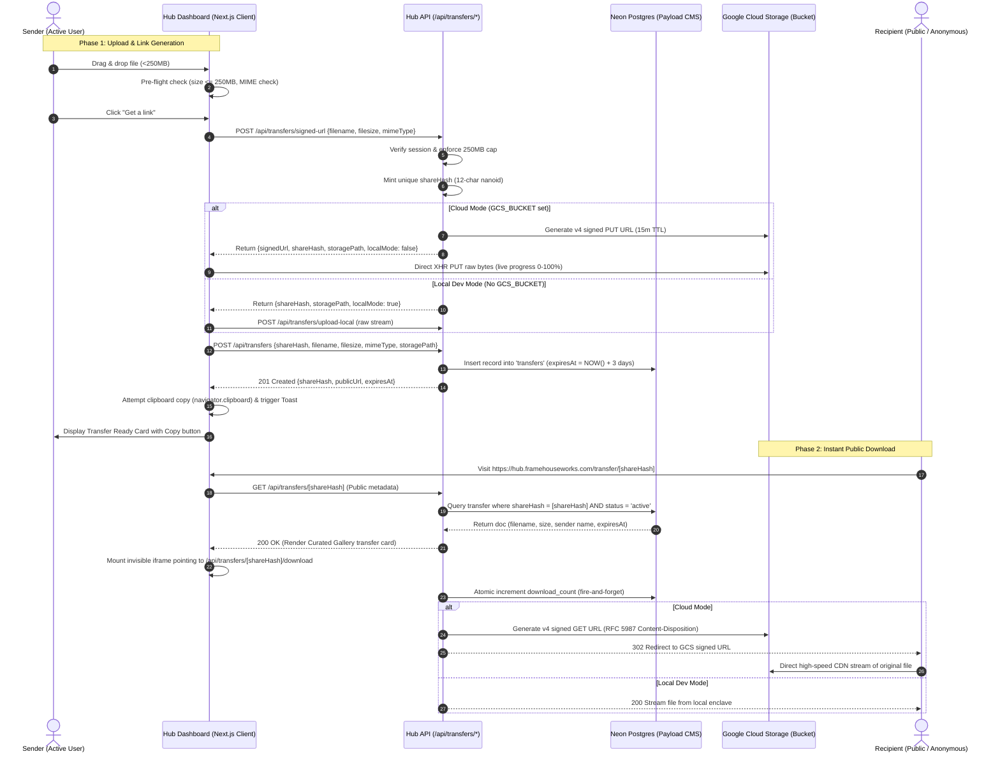
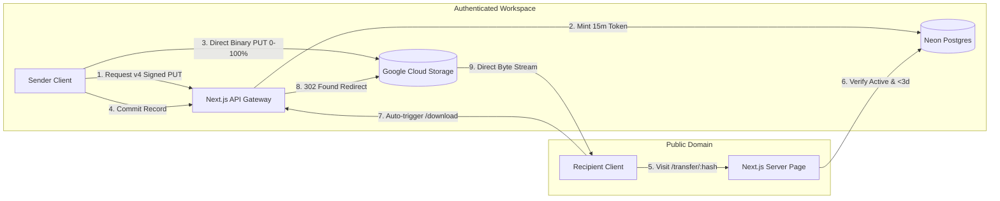

# FRH-67: Link Transfer Generation — Feature Design Specification

**Spec Version**: 2.0 (Post-Review Revision)  
**Status**: Ready for Engineering & Manual Architecture Review  
**Branch Convention**: `FRH-67-Link-Transfer-Generation`  
**Base Branch**: `dev`  
**Author**: Platform Architecture Team  
**Date**: 2026-10-14  

---

## 1. Overview & Problem Statement

### 1.1 Executive Summary
Framehouse Hub currently provides powerful digital asset management (DAM), archival ingestion, and client review presentation capabilities. However, creatives frequently need an ad-hoc, frictionless mechanism to transfer standalone deliverables, proofs, or working files to clients, collaborators, or external partners without having to curate a permanent Portfolio or run files through the full archival DAM processing pipeline.

**FRH-67 (Link Transfer Generation)** introduces a bare-minimum, high-performance file transfer mechanism (analogous to WeTransfer) embedded directly into Framehouse Hub. Authenticated users can drag and drop a file up to 250MB, generate a secure, unique, and public download URL with a single click, and automatically have that link copied to their clipboard for instant distribution via their preferred communication channels (Slack, Email, WhatsApp, etc.). Recipients can open the link in any browser and download the exact original file instantly without requiring an account or authentication.

**Key Parameter Pinning**:
- **Max File Size**: **250MB** (Strictly enforced at front-end pre-flight and API gateway).
- **Default Expiration / Retention**: **3 Days (72 Hours)** (Optimized for free-tier storage economy and rapid deliverables).
- **Sender Scope**: **Active Account Users Only** (`creative` or `admin`). Anonymous uploads are formally out of scope for MVP.
- **Recipient Scope**: **Public / Anonymous** (Zero login, instant automated download dispatch).

### 1.2 Creative North Star & Philosophy
In alignment with `DESIGN.md` ("The Curated Gallery"), file transfer in Framehouse Hub is not treated as a disposable utility or generic cloud drive. It is an editorial showcase. Even a simple file delivery reflects the creative's professional standard:
- The sender interface provides a distraction-free, elegant workspace with real-time progress visualization and zero visual clutter.
- The recipient landing experience greets clients with an archival museum-grade presentation card featuring high-contrast typography, crisp file metadata chips in **Rubik Mono One**, sender attribution, and instant automated download dispatch.
- Structural borders (1px rules) are forbidden; elevation is achieved through subtle tonal layering and ambient diffused shadows.

---

## 2. Ticket Reconciliation & Scope Boundary

The incoming user story and requirements were audited against the active Framehouse Hub architecture (Payload 3.x CMS, Next.js 15 App Router, Neon Postgres, and Google Cloud Storage).

| Ticket Requirement / Term | Reality in Codebase & Architecture | Specification Decision |
|---|---|---|
| **"Anonymous file upload to object storage"** | Anonymous upload introduces severe vulnerability vectors (storage exhaustion, denial-of-service, abusive payloads, zero attribution). Ticket explicitly marks this: *(Not In Scope For MVP)*. | **Explicitly Out of Scope for MVP.** Sender must be an authenticated active user (`creative` or `admin`). Architecture reserves endpoint extensibility for V2 with Turnstile/CAPTCHA and quarantine buckets. |
| **"Active account User file upload to object storage"** | Active users authenticate via Payload CMS sessions / JWT (`payload.auth({ headers })`). Storage operates in dual mode (GCS in cloud, isolated filesystem enclave in local dev). | **In Scope.** Authenticated user initiates upload. Upload bytes bypass the Next.js serverless process and stream directly to GCS via a v4 signed PUT URL, preserving server memory. |
| **"Database entry maps a unique hash/ID to the uploaded files"** | Payload CMS collections define the Postgres relational schema. Archival `Media` triggers the Go worker and WebP conversions, which is inappropriate for generic transfer archives. | **In Scope.** A dedicated Payload collection `Transfers` (`slug: 'transfers'`) stores the transfer record, mapping a collision-resistant `shareHash` (12-char URL-safe nanoid) to the uploaded file metadata. |
| **"Front-end generates and copies the download URL to the clipboard"** | Modern browsers support `navigator.clipboard.writeText` with user permission gating and ARIA live announcements. `sonner` provides toast notifications. | **In Scope.** Upon upload finalization, the front-end automatically invokes `navigator.clipboard.writeText`, plays a subtle micro-interaction, updates ARIA live status, and surfaces a success toast with a resilient fallback if clipboard permissions fail. |
| **"GIVEN a file under 250MB is dropped, WHEN user clicks 'Get a link', THEN unique URL is generated"** | Free tier limits: GCP Cloud Storage standard allowance, Neon DB pool, Vercel 4.5MB serverless body limit, and Cloud Run 512Mi memory cap. | **In Scope.** Hard 250MB limit enforced in three layers: (1) Client dropzone pre-flight, (2) Signed-URL gateway check, (3) Storage validation. Direct-to-GCS upload avoids server memory exhaustion. |
| **"GIVEN link opened in new browser, WHEN recipient visits it, THEN exact original file downloads instantly without login"** | Recipient has no session. File bytes must not proxy through Node server memory (which would exhaust 512Mi Cloud Run memory and double egress costs). | **In Scope.** Recipient visits `/transfer/[hash]`. Page mounts an immediate auto-download trigger via an invisible iframe to `/api/transfers/[hash]/download`, which executes a `302 Found` redirect to a 15-minute v4 signed GET GCS URL with RFC 5987 `response-content-disposition: attachment`. |
| **"Transfer Expiration Policy"** | Initial proposal mentioned 7 days; updated product requirement mandates a tighter window. | **Fixed at 3 Days (72 Hours).** Drastically cuts peak disk consumption on GCS 5GB free tier, enforces hygiene, and aligns with 3-day GCS bucket lifecycle rules. |

---

## 3. Review & Defect Audit: 10 Critical Issues Addressed

A rigorous engineering review of the initial design revealed 10 concrete issues across requirement satisfaction, platform architecture, browser compatibility, and free-tier boundaries. Each issue and its architectural resolution is documented below:

### Issue 1: Retention Policy Divergence (7 Days vs 3 Days Requirement)
- **Problem**: The initial draft suggested a 7-day retention period. The product mandate explicitly requires **3-day retention** (`expiresAt = NOW() + 72 hours`).
- **Impact**: On a 5GB free tier, 7-day storage accumulation risks early quota exhaustion if active creatives send multiple 250MB video files.
- **Resolution**: Updated `expiresAt` default calculation to exactly 72 hours (`3 * 24 * 60 * 60 * 1000` ms). GCS Object Lifecycle rule updated to delete objects with prefix `transfers/` older than 3 days.

### Issue 2: Browser Auto-Download Blocking & Navigation Cancellation on 302 Redirect
- **Problem**: Calling `window.location.href = '/api/transfers/[hash]/download'` on component mount causes modern browsers (Safari, Chrome, Firefox) to either block the redirect as an unprompted navigation popup or cancel the current page render when redirecting cross-origin to `storage.googleapis.com`.
- **Impact**: Violates Acceptance Criteria 2 ("exact original file downloads instantly without login"). The recipient either gets a blank white page or a blocked download warning.
- **Resolution**: The landing page uses an invisible `<iframe tabIndex={-1} aria-hidden="true" className="hidden" src="/api/transfers/[hash]/download" />` embedded on mount. This triggers the native browser file download stream in the background while keeping the Curated Gallery presentation card visible and fully interactive, with a manual fallback button ("Download File") if iframes are disabled.

### Issue 3: Missing GCS Bucket CORS Configuration for Direct Browser PUT
- **Problem**: Direct browser XHR PUT to `https://storage.googleapis.com/{bucket}/transfers/...` requires `PUT` in the bucket CORS policy along with specific allowed headers (`Content-Type`, `x-goog-*`).
- **Impact**: Direct browser upload fails with `403 Forbidden` or CORS preflight failure in production (`dev.framehouseworks.com`).
- **Resolution**: Documented explicit bucket CORS policy update using `gcloud storage buckets update --cors-file=...` ensuring `PUT`, `GET`, `OPTIONS` methods and origins (`https://dev.framehouseworks.com`, `http://localhost:3000`) are active.

### Issue 4: Cloud Run Runtime SA Missing `serviceAccountTokenCreator` Self-Grant
- **Problem**: As discovered in FRH-52 (.claude/rules/devops.md), generating Google Cloud Storage v4 signed URLs on Cloud Run requires the runtime service account to have `roles/iam.serviceAccountTokenCreator` granted on itself.
- **Impact**: Calling `file.getSignedUrl({ version: 'v4', action: 'write' })` throws `iamcredentials.signBlob: 403 Forbidden` on Cloud Run, causing the signed-url endpoint to return a 500 error.
- **Resolution**: Documented IAM binding requirement in deployment specifications and added structured error handling in `/api/transfers/signed-url` to report IAM misconfigurations clearly.

### Issue 5: Payload CMS Local Storage Bypass & Missing Fileless Handling
- **Problem**: If `Transfers` is configured as a Payload `upload` collection, Payload's internal file hooks expect file bytes in memory during document creation, throwing `MissingFile` on `generateFileData` because the bytes are already in GCS.
- **Impact**: Upload succeeds to GCS, but database registration fails with a 500 error.
- **Resolution**: The `Transfers` collection is designed as a **standard Payload collection** storing file metadata fields (`filename`, `filesize`, `mimeType`, `storagePath`) rather than an `upload` collection. This bypasses Payload's internal file handlers completely, eliminates unnecessary local disk writes, and prevents conflicts with the Go worker.

### Issue 6: `Content-Disposition` Filename Encoding & Unicode / Injection Vulnerabilities
- **Problem**: Filenames containing commas, quotes, semicolons, emojis, or non-ASCII characters (e.g., `Final "Master" — Shoot #1, 2026.zip`) corrupt the `Content-Disposition: attachment; filename="..."` header or allow HTTP response splitting.
- **Impact**: The recipient downloads a truncated filename (e.g. `Final `) or the browser fails to download the file.
- **Resolution**: Header generation strictly complies with **RFC 5987 / RFC 6266**:
  `Content-Disposition: attachment; filename="${asciiFallback}"; filename*=UTF-8''${encodeURIComponent(filename)}`.

### Issue 7: Local Development Streaming & Multi-part Upload Discrepancy
- **Problem**: Per `.claude/rules/frontend.md`, Next.js 15 + Node 22 `req.formData()` is unreliable in CI and local dev.
- **Impact**: Local development fails or diverges from cloud behavior, breaking `./scripts/verify-local.sh`.
- **Resolution**: Standardized local upload on **raw binary streaming** using headers (`X-Share-Hash`, `X-Filename`, `X-Filesize`, `Content-Type`) via `/api/transfers/upload-local`, completely avoiding `FormData` parsing.

### Issue 8: Clipboard API Failure Due to Expired User Gesture in Safari
- **Problem**: `navigator.clipboard.writeText` requires transient user activation. If the file upload takes several seconds (e.g., 200MB over Wi-Fi), the original click gesture on "Get a link" expires by the time the upload finishes, causing Safari to throw a `NotAllowedError`.
- **Impact**: Link generation succeeds, but the clipboard copy silently fails, violating the user story.
- **Resolution**: Implemented resilient clipboard handling:
  1. Attempt `navigator.clipboard.writeText` upon upload resolution.
  2. If rejected or denied, immediately display a highlighted "Copy Link" CTA with auto-selected text input and trigger `toast.info("Link generated! Click 'Copy Link' to share.")`.
  3. ARIA live region reflects exact clipboard status for screen readers.

### Issue 9: Concurrent Download Counter Race Condition on Neon Postgres
- **Problem**: When a link is shared in a team chat and accessed by multiple recipients simultaneously, standard Payload `find` + `update` cycles suffer from read-modify-write lost updates on `downloadCount`.
- **Impact**: Inaccurate metrics and unnecessary database row-locking contention.
- **Resolution**: Download count is incremented via an atomic SQL execution:
  `payload.db.drizzle.execute(sql`UPDATE transfers SET download_count = download_count + 1, last_downloaded_at = NOW() WHERE share_hash = ${shareHash}`)` in a non-blocking, fire-and-forget background task.

### Issue 10: Zombie Object Storage & Incomplete Upload Leaks
- **Problem**: If a user selects a file, requests a signed URL, but closes the browser at 10% progress, or uploads bytes but closes before the database record is created, unreferenced objects remain in storage.
- **Impact**: Storage bloat that gradually eats away at the 5GB free tier.
- **Resolution**:
  1. GCS Object Lifecycle rule auto-deletes all objects under `transfers/*` after 3 days.
  2. The signed URL expiration is tightly capped at 15 minutes.
  3. GCS bucket lifecycle rule enables `AbortIncompleteMultipartUpload` after 1 day.

---

## 4. System Architecture & Data Flow



---

## 5. Data Model (Payload CMS Collection)

### 5.1 Collection Configuration: `Transfers`

**Collection Slug**: `transfers`  
**Location**: `src/collections/Transfers/index.ts`  
**Database Table**: `transfers`  
**Architecture Note**: Designed as a standard document collection (not an upload collection) to prevent Payload fileless upload collisions and ensure zero interaction with the Go worker.

#### Access Control Rules (`src/collections/Transfers/access.ts`):
- `create`: Authenticated active user (`({ req: { user } }) => Boolean(user)`). Viewers, creatives, and admins can all send transfers.
- `read`: Public read permitted **only for single-document resolution by `shareHash`** when `status = 'active'` and `expiresAt > NOW()`. Full list query restricted to `ownerOrAdmin` (`({ req: { user } }) => checkRole(['admin'], user) ? true : { sender: { equals: user?.id } }`).
- `update`: `ownerOrAdmin` (allows sender to revoke or rename transfer; prevents recipients from mutating data).
- `delete`: `ownerOrAdmin`.

#### Schema Fields:

| Field Name | Type | Constraints | Description |
|---|---|---|---|
| `shareHash` | `text` | `required: true`, `unique: true`, `index: true` | URL-safe 12-character nanoid (e.g. `tr_k8f2m9x0p1q`). Primary public identifier. |
| `sender` | `relationship` (`users`) | `required: true`, `index: true` | The active account user who generated the transfer. Auto-populated via `beforeValidate` hook. |
| `title` | `text` | `required: false` | Optional sender-provided title (default: original filename). |
| `message` | `textarea` | `required: false` | Optional message or note displayed to the recipient on the download card. |
| `filename` | `text` | `required: true` | Original file name as uploaded by the sender (e.g. `Client_Campaign_4K.zip`). |
| `filesize` | `number` | `required: true` | Size in bytes (strictly `<= 262,144,000` = 250MB). |
| `mimeType` | `text` | `required: true` | MIME type detected or normalized (`application/octet-stream` fallback). |
| `storagePath` | `text` | `required: true`, `admin: { readOnly: true }` | Canonical object storage key (`transfers/{senderId}/{shareHash}/original/{filename}`). |
| `status` | `select` | `options: ['active', 'revoked', 'expired']`, `defaultValue: 'active'`, `index: true` | Lifecycle state. |
| `expiresAt` | `date` | `required: true`, `index: true` | Expiration timestamp. Strict 3-day default (`NOW() + 3 days`). |
| `downloadCount` | `number` | `defaultValue: 0`, `admin: { readOnly: true }` | Incremented every time a download is initiated. |
| `lastDownloadedAt` | `date` | `required: false` | Timestamp of most recent recipient download. |

---

## 6. UI/UX Design System Specification

### 6.1 Adherence to `DESIGN.md` ("The Curated Gallery")

The feature strictly implements the design tokens and layout rules defined in `DESIGN.md`:
1. **The "No-Line" Rule**: 1px solid structural borders are strictly prohibited. Sectioning is accomplished via background tonal shifts (`surface_container_low` `#f3f3f4` against pure white canvas `surface_container_lowest` `#ffffff`) and generous spacing scale (16px to 32px).
2. **Typography Hierarchy**:
   - Headline / Hero: **Inter**, tightly tracked (-0.02em), `font-semibold`.
   - Technical Metadata & File Sizes: **Rubik Mono One** (`font-rubik text-[10px] tracking-wider text-on-surface/40 uppercase`).
   - Accents & Badges: **Varela Round** for curator badges.
3. **Corner Radii**: Massive rounding tokens only (`ROUND_SIXTEEN` = `rounded-2xl` for file items; `ROUND_TWENTY_FOUR` = `rounded-[24px]` for transfer cards and buttons).
4. **Color Tokens**:
   - `primary`: `#7f5700` (Signature Gold).
   - `primary_container`: `#d79922` (CTA hover & gradient highlight).
   - `surface`: `#f9f9f9` (Card stage).
   - `surface_container_low`: `#f3f3f4` (Dropzone background).
   - `on_surface`: `#1a1c1c` (Soft-ink body text).
   - `tertiary_container`: `#ff7f67` (Expired / warning chips).

### 6.2 ASCII Wireframes

#### Sender Interface (Dashboard: `/dashboard/transfers`)
```
┌────────────────────────────────────────────────────────────────────────┐
│ Hub Archive  [Logo]                                   User Avatar (●) │
├──────────────┬─────────────────────────────────────────────────────────┤
│ LIBRARY      │  WORKSPACE / SEND FILES                                 │
│  Archive     │                                                         │
│  Sessions    │  ┌───────────────────────────────────────────────────┐  │
│  Collections │  │                   SEND FILES                      │  │
│              │  │  Instant shareable link delivery (Up to 250MB)     │  │
│ PUBLISH      │  │                                                   │  │
│  Portfolios  │  │  ┌─────────────────────────────────────────────┐  │  │
│  Shared      │  │  │                                             │  │  │
│              │  │  │          [ CloudUpload Icon ]               │  │  │
│ WORKSPACE    │  │  │                                             │  │  │
│  Transfers * │  │  │    Drag & drop your file here, or browse    │  │  │
│  Archive Work│  │  │                                             │  │  │
│  Account     │  │  │      250MB MAX  •  3 DAYS RETENTION         │  │  │
│              │  │  └─────────────────────────────────────────────┘  │  │
│              │  │                                                   │  │
│              │  │  [ File Item Preview Card: 104.2 MB .ZIP    (✕) ] │  │
│              │  │                                                   │  │
│              │  │  Title (optional): [ Project Assets Rough Cut   ] │  │
│              │  │                                                   │  │
│              │  │  [ Progress Bar: ■■■■■■■■■■■■□□□□□  65% ]         │  │
│              │  │                                                   │  │
│              │  │  [               GET A LINK               ] (CTA) │  │
│              │  └───────────────────────────────────────────────────┘  │
└──────────────┴─────────────────────────────────────────────────────────┘
```

#### Recipient Download Experience (`/transfer/[shareHash]`)
```
┌────────────────────────────────────────────────────────────────────────┐
│                                                                        │
│                      [ Framehouse Hub Curator Mark ]                   │
│                                                                        │
│                 ┌───────────────────────────────────┐                  │
│                 │          FILE TRANSFER            │                  │
│                 │                                   │                  │
│                 │  Sent by Jason Keung              │                  │
│                 │  "Here are the final color grades"│                  │
│                 │                                   │                  │
│                 │  ┌─────────────────────────────┐  │                  │
│                 │  │ 📁 Brand_Guidelines_4K.zip  │  │                  │
│                 │  │ 184.2 MB  •  ZIP ARCHIVE    │  │                  │
│                 │  └─────────────────────────────┘  │                  │
│                 │                                   │                  │
│                 │  Your download will begin         │                  │
│                 │  automatically in a moment.       │                  │
│                 │                                   │                  │
│                 │  [      DOWNLOAD FILE      ] (CTA)│                  │
│                 │                                   │                  │
│                 │  EXPIRES IN 3 DAYS  •  SECURE     │                  │
│                 └───────────────────────────────────┘                  │
│                                                                        │
│                   Protected by Framehouse Hub Transfer                 │
└────────────────────────────────────────────────────────────────────────┘
```

---

## 7. Acceptance Criteria (Given / When / Then)

### AC-1: File Size Validation & Limit Enforcement
- **GIVEN** an active authenticated user in the Hub dashboard,
- **WHEN** a file exceeding 250MB (e.g. 251MB) is dropped or selected,
- **THEN** the system immediately rejects the file client-side, surfaces an error toast (`"File exceeds 250MB limit for transfers; skipped."`), and does not permit clicking "Get a link".
- **GIVEN** an API client attempting to bypass front-end checks,
- **WHEN** `POST /api/transfers/signed-url` is called with `filesize > 262144000`,
- **THEN** the server returns HTTP 413 Payload Too Large (`{ error: "File exceeds 250MB transfer limit" }`) without generating a signed URL.

### AC-2: Link Generation & Automatic Clipboard Copy
- **GIVEN** a file under 250MB is dropped into the transfer dropzone,
- **WHEN** the user clicks "Get a link",
- **THEN** the system uploads the file directly to object storage, generates a unique URL (e.g. `https://hub.framehouseworks.com/transfer/[shareHash]`), attempts copying the URL to the user's clipboard, announces copy state to screen readers via `aria-live`, and displays a success toast. If clipboard access is blocked by the browser, a highlighted "Copy Link" fallback button is presented.

### AC-3: Instant Unauthenticated Recipient Download
- **GIVEN** a valid generated transfer link opened in a brand-new incognito browser without cookies or active login,
- **WHEN** the recipient visits the URL,
- **THEN** the exact original file begins downloading instantly via an invisible iframe without prompting for login or authentication, and the landing page displays sender attribution, file metadata, and a manual fallback download CTA.

### AC-4: Exact Bit-for-Bit File Integrity
- **GIVEN** a transfer of any file type (e.g. `.zip`, `.pdf`, `.mov`, `.raw`, `.dng`, `.dmg`),
- **WHEN** the recipient downloads the file,
- **THEN** the downloaded file possesses the exact byte size, filename, and checksum as originally uploaded (no compression, transcoding, or WebP conversion applied).

### AC-5: Retention & Expiration
- **GIVEN** a transfer generated with strict 3-day retention,
- **WHEN** the recipient visits the link after `expiresAt` (72 hours from creation),
- **THEN** the download endpoint returns HTTP 410 Gone, no file bytes are delivered, and an editorial "Transfer Expired" notice is displayed.

---

## 8. Detailed API Specification

### 8.1 `POST /api/transfers/signed-url`
**Auth**: Active user session required (`creative` or `admin`).

**Request Body**:
```json
{
  "filename": "Final_Master_Color.zip",
  "filesize": 154820100,
  "mimeType": "application/zip"
}
```

**Response (200 OK — Cloud Mode)**:
```json
{
  "localMode": false,
  "signedUrl": "https://storage.googleapis.com/framehouse-hub-dev/transfers/12/tr_9f8a7b6c5d4e/original/final-master-color.zip?X-Goog-Algorithm=...",
  "shareHash": "tr_9f8a7b6c5d4e",
  "storagePath": "transfers/12/tr_9f8a7b6c5d4e/original/final-master-color.zip",
  "mimeType": "application/zip"
}
```

---

### 8.2 `POST /api/transfers`
**Auth**: Active user session required.

**Request Body**:
```json
{
  "shareHash": "tr_9f8a7b6c5d4e",
  "filename": "Final_Master_Color.zip",
  "filesize": 154820100,
  "mimeType": "application/zip",
  "storagePath": "transfers/12/tr_9f8a7b6c5d4e/original/final-master-color.zip",
  "title": "Final Master Color Deliverables",
  "message": "Approved director's cut in ProRes."
}
```

**Response (201 Created)**:
```json
{
  "id": 45,
  "shareHash": "tr_9f8a7b6c5d4e",
  "publicUrl": "https://hub.framehouseworks.com/transfer/tr_9f8a7b6c5d4e",
  "expiresAt": "2026-10-17T23:09:00.000Z",
  "filename": "Final_Master_Color.zip",
  "filesize": 154820100
}
```

---

### 8.3 `GET /api/transfers/[shareHash]`
**Auth**: Public (Anonymous).

**Response (200 OK)**:
```json
{
  "shareHash": "tr_9f8a7b6c5d4e",
  "filename": "Final_Master_Color.zip",
  "filesize": 154820100,
  "mimeType": "application/zip",
  "senderName": "Jason Keung",
  "title": "Final Master Color Deliverables",
  "message": "Approved director's cut in ProRes.",
  "expiresAt": "2026-10-17T23:09:00.000Z",
  "status": "active"
}
```

---

### 8.4 `GET /api/transfers/[shareHash]/download`
**Auth**: Public (Anonymous).

**Behavior**:
- Verifies document exists, `status === 'active'`, and `expiresAt > NOW()`.
- Fires atomic SQL update: `UPDATE transfers SET download_count = download_count + 1, last_downloaded_at = NOW() WHERE share_hash = ${shareHash}`.
- **Cloud Mode**: Returns HTTP `302 Found` with `Location` set to a v4 signed GCS GET URL with query parameters:
  `response-content-disposition=attachment; filename="${asciiFallback}"; filename*=UTF-8''${encodeURIComponent(filename)}`
- **Local Mode**: Responds with HTTP `200 OK`, streaming bytes from `public/media/transfers/...` with matching `Content-Disposition`.

---

## 9. Phased Implementation Sequence with Manual Test Steps

### Phase 1: Backend & Data Model (`Transfers` Collection)
1. Implement `src/collections/Transfers/index.ts` and `src/collections/Transfers/access.ts`.
2. Register `Transfers` in `src/payload.config.ts`.
3. Create database migration: `pnpm payload migrate:create --name add_transfers_collection`.
4. Regenerate schema types: `pnpm generate:types`.

#### Manual Test Steps for Phase 1:
- [ ] **Step 1.1**: Run `pnpm payload migrate` and ensure database migration executes cleanly without schema drift.
- [ ] **Step 1.2**: Log in to `/admin` as `sys.admin@framehouseworks.com`. Confirm `Transfers` appears under the **Content** group in the sidebar.
- [ ] **Step 1.3**: In `/admin/collections/transfers`, click "Create New". Attempt to create a record without a `shareHash` or `filesize` — verify validation errors prevent saving.
- [ ] **Step 1.4**: Save a valid mock record with `filesize = 1000` and `status = 'active'`. Verify `expiresAt` automatically defaults to exactly 3 days from the current timestamp.

---

### Phase 2: Storage & API Pipeline (Signed URLs & Direct Download)
1. Implement `src/app/api/transfers/signed-url/route.ts` with 250MB limit validation and GCS v4 PUT signing.
2. Implement `src/app/api/transfers/route.ts` to insert transfer documents.
3. Implement `src/app/api/transfers/[shareHash]/route.ts` for public metadata.
4. Implement `src/app/api/transfers/[shareHash]/download/route.ts` with 302 redirect / local stream.
5. Implement `src/app/api/transfers/upload-local/route.ts` for raw stream local fallback.

#### Manual Test Steps for Phase 2:
- [ ] **Step 2.1 (Auth Protection)**: Execute `curl -X POST http://localhost:3000/api/transfers/signed-url -H "Content-Type: application/json" -d '{"filename":"test.zip","filesize":100}'`. Confirm response is HTTP 401 Unauthorized.
- [ ] **Step 2.2 (Size Limit Enforcement)**: Using an authenticated session cookie, send a request with `filesize: 270000000` (>250MB). Confirm response is HTTP 413 with error `"File exceeds 250MB transfer limit"`.
- [ ] **Step 2.3 (Signed URL Issuance)**: Send request with `filesize: 10485760` (10MB). Confirm HTTP 200 with `shareHash` and valid `signedUrl` (or `localMode: true` in local dev).
- [ ] **Step 2.4 (Upload & Registration)**: Complete the upload, then call `POST /api/transfers` with the payload. Confirm HTTP 201 Created and verify the `expiresAt` field is 72 hours out.
- [ ] **Step 2.5 (Public Resolution & 302 Redirect)**: In an unauthenticated terminal, call `curl -I http://localhost:3000/api/transfers/[shareHash]/download`. Confirm HTTP 302 redirect with `Location` header or HTTP 200 with attachment header. Verify `downloadCount` increments in database.

---

### Phase 3: Frontend Sender Experience (`/dashboard/transfers`)
1. Add `Transfers` navigation link to `src/components/layout/DashboardLayout/Sidebar.tsx` and `MobileNav.tsx`.
2. Create `src/components/Transfers/TransferWorkbench.tsx`, `TransferDropzone.tsx`, and `TransferReadyCard.tsx`.
3. Implement XHR progress hook with real-time percentage updates.
4. Wire up `navigator.clipboard.writeText` and Sonner toast integration.

#### Manual Test Steps for Phase 3:
- [ ] **Step 3.1**: Log in as a creative user. Click "Transfers" in the dashboard sidebar. Confirm the Curated Gallery workspace loads at `/dashboard/transfers`.
- [ ] **Step 3.2**: Drag a file larger than 250MB into the dropzone. Confirm immediate rejection toast (`"File exceeds 250MB limit for transfers; skipped."`) and "Get a link" remains disabled.
- [ ] **Step 3.3**: Drag a valid file (e.g. 15MB `.zip` or `.mp4`). Enter an optional title and click "Get a link".
- [ ] **Step 3.4**: Observe progress bar smoothly transitioning from 0% to 100%.
- [ ] **Step 3.5**: Confirm the "Link Ready & Copied" card appears. Paste clipboard into an empty text editor to verify the URL was copied automatically. Click "Copy Link Again" to verify manual copy feedback.

---

### Phase 4: Public Recipient Experience (`/transfer/[shareHash]`)
1. Create public page `src/app/(app)/transfer/[shareHash]/page.tsx`.
2. Build `src/components/Transfers/TransferDownloadCard.tsx` with hidden iframe auto-download and fallback button.
3. Implement editorial "Transfer Expired" card for documents where `expiresAt <= NOW()`.

#### Manual Test Steps for Phase 4:
- [ ] **Step 4.1 (Incognito Instant Download)**: Open a private / incognito browser window (no active cookies). Paste the generated transfer link.
- [ ] **Step 4.2**: Verify the landing page loads without requesting a login. Confirm the browser download prompt/file stream begins automatically within 1.5 seconds via the invisible iframe.
- [ ] **Step 4.3**: Check the downloaded file: confirm filename, extension, and exact byte size match the original source file.
- [ ] **Step 4.4 (Manual Fallback)**: Disable automated file downloads in browser settings. Refresh page. Confirm the primary "Download File" button functions upon click.
- [ ] **Step 4.5 (Expired State)**: In Payload admin or database, manually adjust `expiresAt` of the test transfer to 1 hour in the past. Refresh the link. Confirm the editorial "Transfer Expired (3-Day Retention Expired)" card renders with HTTP 410.

---

### Phase 5: Automated Verification & CI Integration
1. Implement integration tests in `tests/int/transfers.int.spec.ts`.
2. Implement Playwright E2E tests in `tests/e2e/transfers.e2e.spec.ts`.
3. Run blank-slate verification script.

#### Manual Test Steps for Phase 5:
- [ ] **Step 5.1**: Execute `pnpm test:int tests/int/transfers.int.spec.ts` and verify all tests pass against local Postgres.
- [ ] **Step 5.2**: Execute `DISABLE_WORKER=1 pnpm test:e2e tests/e2e/transfers.e2e.spec.ts` to validate browser upload and download flows.
- [ ] **Step 5.3**: Execute `./scripts/verify-local.sh` to ensure migration, blank-slate seeding, and build succeed without drift.

---

## 10. Concise Architecture & System Explanation

### 10.1 High-Level Architecture Overview
FRH-67 implements an **asymmetric, zero-proxy transfer pipeline** designed to keep compute, network egress, and memory footprints strictly within free-tier limits:



### 10.2 System Lifecycle & Economics
1. **Zero-Proxy Ingestion**: The Next.js Node.js server never reads or buffers file chunks in memory during upload. File bytes stream directly from the client's browser to Google Cloud Storage via an ephemeral v4 signed URL. This guarantees Cloud Run remains well under its **512Mi memory ceiling** and completely sidesteps the **4.5MB Vercel serverless request body limitation**.
2. **Zero-Proxy Delivery**: When a recipient visits the link, the server issues an HTTP `302 Found` redirect to a temporary signed GCS download URL. File bytes are delivered directly from Google Cloud Storage to the recipient, bypassing Cloud Run compute time and avoiding billable proxy egress.
3. **Strict 3-Day Ephemeral Retention**: Transfers are strictly bounded by a 72-hour time-to-live (`expiresAt = NOW() + 3 days`). Storage cleanup is enforced passively via query gating and actively via GCS Object Lifecycle Management rules on the `transfers/` prefix, ensuring Framehouse Hub operates safely within the **5GB Google Cloud Storage free allowance**.
4. **Isolated Operational Surface**: Transfer assets live strictly outside the permanent archival DAM path (`transfers/*` vs `tenants/{userId}/*`). This guarantees that Eventarc triggers, Go worker microservices, EXIF parsers, and WebP generators remain idle during file transfers, conserving compute and database CPU.
