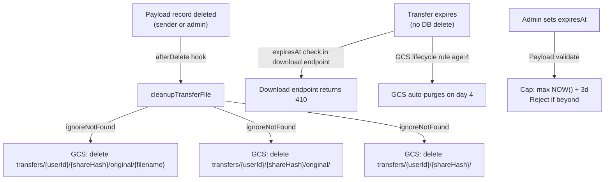

> **IMPLEMENTATION STATUS: SPECCED — NOT STARTED** — Follows on from FRH-67 (Link Transfer Generation). No code changes have been made. Addresses two storage hygiene gaps discovered post-implementation of `cleanupTransferFile`.

---

# FRH-68 — File Download Expiry & Purge

> **North Star:** Storage state should always be an exact mirror of database state. When a transfer record is gone or expired, nothing attributable to it should remain in GCS. An admin browsing the bucket should see a clean surface.

---

## 1. Problem Statement

FRH-67 shipped the `cleanupTransferFile` `afterDelete` hook, which deletes the GCS object when a transfer Payload record is deleted. Two gaps were identified in post-implementation review:

### Gap A — Ghost folder structure after deletion

GCS is a flat object store with no real directories. "Folders" visible in the Console are virtual prefixes derived from object keys. However, the GCS Console and `gcloud storage ls` may surface zero-byte placeholder objects (e.g. created by prior manual browsing, `gsutil` sessions, or certain client upload paths). When the file object is deleted by `cleanupTransferFile`, these placeholder prefix objects are not addressed, leaving:

```
transfers/{userId}/{shareHash}/            ← placeholder may remain
transfers/{userId}/{shareHash}/original/   ← placeholder may remain
transfers/{userId}/                        ← placeholder may remain
```

An admin manually inspecting the bucket sees empty folder ghosts for every transfer ever created and deleted. This is poor hygiene and erodes confidence in storage integrity.

### Gap B — Expiry/lifecycle misalignment

The current system uses two independent mechanisms to control transfer availability:

| Mechanism | What it controls | Awareness of the other |
|---|---|---|
| `expiresAt` in Postgres | Whether the download endpoint serves the link | None — blind to GCS state |
| GCS lifecycle rule `age: 3` on `transfers/` prefix | When GCS deletes the bytes | None — blind to `expiresAt` |

This creates divergent scenarios for non-default expiry values:

| Scenario | Link accessible? | Bytes in GCS? | Outcome |
|---|---|---|---|
| Default `expiresAt = 3d`, within window | ✅ Yes | ✅ Yes | ✅ Correct |
| Admin sets `expiresAt` shorter (e.g. 1d) | ❌ No — link dead | ✅ Yes — until day 3 | ⚠️ Orphaned bytes, harmless, auto-purged on day 3 |
| Admin sets `expiresAt` longer (e.g. 7d) | ❌ No — link dead after day 3 | ❌ No — GCS purged on day 3 | 🔴 Link appears active in DB; download returns 500 from GCS |
| Sender/admin deletes Payload record | ❌ No | ❌ No — hook fires immediately | ✅ Correct — only guaranteed-sync path |

**The critical gap:** if an admin sets `expiresAt` beyond 3 days, the DB record shows the link as active but GCS has already purged the file. The download endpoint will return a 500/404 from GCS. The admin UI currently has no guard preventing this.

---

## 2. Scope

**In scope (this ticket):**
- Fix `cleanupTransferFile` to delete GCS folder placeholder objects on deletion
- Add GCS lifecycle rule on `transfers/` prefix as a dead-man's switch (belt-and-suspenders)
- Add field-level `validate` on `expiresAt` in the `Transfers` collection to cap at `NOW() + 3 days`
- Update `scripts/infra/` to include lifecycle rule application
- Document the infra change in `docs/devops/gcp-infrastructure.md`

**Out of scope:**
- Dynamic expiry adjustment (changing lifecycle rule age per-record) — GCS lifecycle rules have no per-object TTL awareness
- Automated DB reconciliation job — deferred
- Separate GCS bucket for transfers — considered, rejected for now (see §7)

---

## 3. Fix A — cleanupTransferFile Folder Placeholder Purge

The `afterDelete` hook in `src/collections/Transfers/hooks/cleanupTransferFile.ts` currently only deletes the file object at `storagePath`. The fix adds explicit deletion of the two folder placeholder paths that GCS may have created:

```
storagePath:                transfers/{userId}/{shareHash}/original/{filename}
Placeholder 1 (to purge):  transfers/{userId}/{shareHash}/original/
Placeholder 2 (to purge):  transfers/{userId}/{shareHash}/
```

All three deletions use `{ ignoreNotFound: true }` — safe regardless of whether the placeholder exists. This is consistent with the pattern used in `src/lib/cleanup-failed-storage.ts`.

**Path derivation logic:**

```
storagePath parts: [transfers, {userId}, {shareHash}, original, {filename}]
shareHashDir = parts[0..2].join('/')   →  transfers/{userId}/{shareHash}
```

The `transfers/{userId}/` prefix is intentionally **not purged** — other transfers from the same user may still be active under it. Only the per-share-hash enclave is cleaned.

---

## 4. Fix B — GCS Lifecycle Rule on `transfers/` Prefix

A GCS object lifecycle rule scoped to the `transfers/` prefix acts as a dead-man's switch. Even if the `cleanupTransferFile` hook fails (transient error, service unavailability), or a transfer record is orphaned without triggering the hook, bytes will be removed within 4 days.

**Rule definition (`scripts/infra/lifecycle-transfers.json`):**

```json
{
  "lifecycle": {
    "rule": [
      {
        "action": { "type": "Delete" },
        "condition": {
          "matchesPrefix": ["transfers/"],
          "age": 4
        }
      }
    ]
  }
}
```

`age: 4` (not 3) is deliberate — the hook fires synchronously on delete and covers the 3-day case; the lifecycle rule exists as a fallback for orphans, not the primary path. Setting it to 3 would race with legitimate active transfers on their final day.

**Application command:**

```bash
gcloud storage buckets update gs://${GCS_BUCKET} \
  --lifecycle-file=scripts/infra/lifecycle-transfers.json
```

This command is idempotent and must be run once per environment (dev and prod). It should be added to `scripts/infra/setup-eventarc.sh` so all infra provisioning is co-located.

> **Note:** GCS lifecycle rules evaluate once per day. A rule with `age: 4` will delete objects sometime between day 4 and day 5 after creation — not at a precise timestamp. This is acceptable for a fallback path.

---

## 5. Fix C — Admin UI Guard: Cap `expiresAt` to 3 Days

The `Transfers` collection `expiresAt` field currently has no upper-bound validation. An admin can set any future date, which will silently break the download link on day 3 when GCS purges the bytes.

**Resolution:** Add a field-level `validate` function on `expiresAt` in `src/collections/Transfers/index.ts`:

- Maximum allowed value: `NOW() + 3 days` (matching the GCS lifecycle rule)
- Error message surfaces in the Payload admin UI inline, preventing save
- The `setTransferDefaults` hook that sets the initial 3-day value is unchanged
- This is a **server-side** validate — it runs at the Payload collection layer, not only in the browser

**Behaviour matrix post-fix:**

| Admin sets `expiresAt` | Outcome |
|---|---|
| ≤ 3 days from now | ✅ Accepted — consistent with GCS lifecycle |
| > 3 days from now | ❌ Rejected at save — inline validation error in admin UI |
| Blank / missing | ❌ Rejected — field is `required` |

---

## 6. Architecture Diagram — Post-Fix State



---

## 7. Considered and Rejected: Separate GCS Bucket for Transfers

A dedicated `gs://framehouse-hub-transfers-dev` bucket was considered to enable a tighter lifecycle rule (`age: 3`) without risk of affecting the `tenants/` media objects. Rejected for the following reasons:

- Adds a second bucket, second CORS configuration, second set of IAM bindings — significant infra complexity for a free-tier project
- The `matchesPrefix` condition on the lifecycle rule achieves the same scoping within the existing bucket
- Per `.claude/rules/devops.md`: bucket region must match Eventarc trigger region; a second bucket adds no Eventarc value for transfers (transfers are not processed by the Go worker)

This decision should be revisited if transfers storage grows significantly or if a separate data-retention policy is required for compliance.

---

## 8. Files to Create / Modify

| File | Action | Description |
|---|---|---|
| `src/collections/Transfers/hooks/cleanupTransferFile.ts` | **Modify** | Add deletion of `shareHash/` and `shareHash/original/` placeholder objects in GCS cloud path |
| `src/collections/Transfers/index.ts` | **Modify** | Add `validate` on `expiresAt` field capping to `NOW() + 3 days` |
| `scripts/infra/lifecycle-transfers.json` | **Create** | GCS lifecycle rule JSON for `transfers/` prefix with `age: 4` |
| `scripts/infra/setup-eventarc.sh` | **Modify** | Append `gcloud storage buckets update --lifecycle-file` command |
| `docs/devops/gcp-infrastructure.md` | **Modify** | Add "Transfer lifecycle rule" section under GCS Bucket |

---

## 9. Acceptance Criteria

- [ ] After a transfer record is deleted, `gcloud storage ls gs://${GCS_BUCKET}/transfers/{userId}/{shareHash}/` returns empty or no such prefix
- [ ] `gcloud storage ls gs://${GCS_BUCKET}/transfers/` shows no ghost folder entries for deleted transfers
- [ ] GCS lifecycle rule is applied to `gs://framehouse-hub-dev` and `gs://framehouse-hub-prod` with `matchesPrefix: ["transfers/"]`, `age: 4`
- [ ] Attempting to save a `Transfers` record in Payload admin with `expiresAt` > 3 days from now shows an inline validation error and blocks save
- [ ] Default `expiresAt` (3 days, set by `setTransferDefaults`) continues to pass validation without error
- [ ] `cleanupTransferFile` GCS deletions all use `{ ignoreNotFound: true }` — no errors thrown when placeholders don't exist
- [ ] Integration test (`tests/int/transfers.int.spec.ts`) covers: delete hook removes file object; extended-expiry validation rejects at > 3d

---

## 10. Open Questions

1. **Lifecycle rule: dev only or prod from day one?** Recommend applying to both environments simultaneously since it's a safety net — prod transfers should not have dangling orphans either.
2. **Existing orphans:** Should a one-time cleanup script be run against the bucket to purge any ghost prefixes created before this fix lands? Low priority given small user base, but worth a `gcloud storage rm --recursive` sweep at deploy time.
3. **expiresAt cap — UI feedback clarity:** Should the admin UI show the hard cap (e.g. "Maximum: {date+3d}") as helper text on the field, or only surface it on failed save? Recommend helper text to avoid a confusing save failure.
