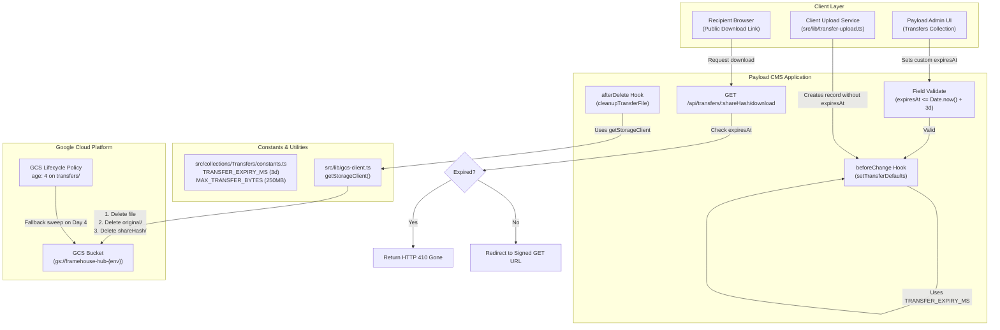

> **IMPLEMENTATION STATUS: SPECCED — REVISED (ROBUST ARCHITECTURE)** — Follows on from FRH-67 (Link Transfer Generation). No code changes have been made. Addresses storage hygiene, lifecycle alignment, code duplication, and administrative guardrails.
>
> **Pre-conditions:** FRH-67 branch (`FRH-67-Link-Transfer-Generation`) must be merged before this ticket begins. All file paths below assume FRH-67 code is present on the target branch.

---

# FRH-68 — File Download Expiry & Purge

> **North Star:** Storage state must be an exact mirror of database state at all times. When a transfer is deleted or expires, every attributable byte and every visible folder prefix in GCS must be removed. An admin browsing the bucket should see a clean surface, and the codebase must adhere to DRY principles with single sources of truth.

---

## 1. Problem Statement

FRH-67 implemented the baseline link transfer feature, including `cleanupTransferFile` (`afterDelete` hook) and `set-transfers-lifecycle.sh` (GCS lifecycle rule, `age: 3`). A deep architectural analysis identified two storage hygiene gaps and three codebase design liabilities:

### Gap A — Ghost folder prefixes survive file deletion
GCS is an object store without real directories; "folders" in the Google Cloud Console are virtual key prefixes. However, browser uploads, tooling, and Console interactions frequently create zero-byte placeholder objects ending in `/` to mimic directory nodes.
Currently, `cleanupTransferFile` deletes only the exact file object at `storagePath`:
```
transfers/{userId}/{shareHash}/original/{filename}  ← ✅ deleted by hook
transfers/{userId}/{shareHash}/original/            ← ❌ zero-byte placeholder may remain
transfers/{userId}/{shareHash}/                     ← ❌ zero-byte placeholder may remain
```
Deleted transfers leave ghost folder entries permanently visible in the GCS Console.

### Gap B — Expiry & lifecycle misalignment when `expiresAt` is edited
The system operates two independent expiration mechanisms:
1. **Database `expiresAt` (Postgres):** Evaluated by the download endpoint (`/:shareHash/download`) and public page. Serves HTTP 410 when expired.
2. **GCS Lifecycle Rule (`transfers/` prefix):** Background daily batch evaluation by GCP Cloud Storage.

| Scenario | Link Live? | Bytes in GCS? | Outcome |
|---|---|---|---|
| Default `expiresAt = 3d`, within window | ✅ Yes | ✅ Yes | ✅ Expected normal flow |
| Admin sets `expiresAt` shorter (e.g., 1d) | ❌ Dead on day 1 (410) | ✅ Yes — until GCS purges | ⚠️ Benign; bytes auto-purged on schedule |
| Admin sets `expiresAt` longer (e.g., 7d) | ❌ Dead on day 3/4 | ❌ GCS purges file | 🔴 Broken link: DB shows valid, download fails |
| Sender/admin deletes Payload document | ❌ No | ❌ Purged immediately | ✅ Synchronous cleanup via `afterDelete` hook |

**Critical risk:** If an administrator extends `expiresAt` beyond the GCS lifecycle threshold in the Payload Admin UI, the database reports the transfer as valid, but GCS deletes the underlying file, causing download attempts to fail.

### Gap C — Code duplication & fragmented constants
- **Duplicated GCS Client:** The GCS `Storage` client initialization logic (credential parsing, project ID resolution, ADC fallback) is currently copied across 5 different files (`endpoints.ts`, `cleanupTransferFile.ts`, `cleanup-failed-storage.ts`, `signCloudUrls.ts`, and `signed-url/route.ts`).
- **Scattered Constants:** Transfer retention duration (`THREE_DAYS_MS = 3 * 24 * 60 * 60 * 1000`) and size limits (`MAX_TRANSFER_BYTES = 250MB`) are hardcoded locally across multiple files without a single source of truth.

---

## 2. Scope & Design Principles

### In Scope
1. **Shared GCS Client Utility (`src/lib/gcs-client.ts`):** Extract a centralized, cached `getStorageClient()` function to eliminate duplicated storage instantiation logic across the application.
2. **Centralized Transfer Constants (`src/collections/Transfers/constants.ts`):** Define `TRANSFER_EXPIRY_MS` (72 hours), `MAX_TRANSFER_BYTES` (250MB), and path utilities in one module.
3. **Enhanced `cleanupTransferFile` Hook:** Purge both zero-byte folder placeholder objects (`shareHash/original/` and `shareHash/`) alongside the physical file object upon document deletion, protected by a strict path-shape guard.
4. **Lifecycle Rule Buffer (`age: 4`):** Update `scripts/infra/set-transfers-lifecycle.sh` from `age: 3` to `age: 4` to prevent race conditions for end-of-day uploads.
5. **Multi-Environment Standard from Day 1:** Apply identical lifecycle rules and standards to both `framehouse-hub-dev` and `framehouse-hub-prod`.
6. **Payload Admin UI Guardrail & Helper Text:** Add server-side `validate` logic capping `expiresAt` at `NOW() + 3 days` and provide proactive helper text via `admin.description`.
7. **Safe One-Time Orphan Sweep:** Provide an idempotent, non-destructive script that lists and filters objects strictly by `size=0` before deletion.
8. **Platform Free-Tier Compliance:** Maintain strict compliance with GCP Always-Free limits (5GB storage, 5k Class A, 50k Class B operations).
9. **Infrastructure Documentation:** Document all lifecycle and bucket configurations in `docs/devops/gcp-infrastructure.md`.

### Out of Scope
- Dynamic per-object TTL rules in GCS (GCS lifecycle conditions do not support arbitrary metadata timestamps).
- Automated background DB-to-GCS audit daemon (unnecessary operational overhead for MVP scale).
- Separate GCS bucket for transfers (rejected to preserve unified IAM, CORS, and free-tier allocation; see §8).

---

## 3. Architecture & Shared Foundations

### 3.1 Centralized Transfer Constants (`src/collections/Transfers/constants.ts`)

To avoid magic numbers and drift across client services, hooks, endpoints, and validation, all transfer parameters are declared in a dedicated constants module:

```typescript
// Strict 3-day (72-hour) retention policy
export const TRANSFER_EXPIRY_DAYS = 3
export const TRANSFER_EXPIRY_MS = TRANSFER_EXPIRY_DAYS * 24 * 60 * 60 * 1000 // 259,200,000 ms

// Maximum transfer upload size: 250MB
export const MAX_TRANSFER_BYTES = 250 * 1024 * 1024

// Canonical storage path prefix
export const TRANSFERS_PREFIX = 'transfers'

// GCS Lifecycle rule age (includes 1-day safety buffer)
export const GCS_LIFECYCLE_AGE_DAYS = 4
```

### 3.2 Shared GCS Client Utility (`src/lib/gcs-client.ts`)

Instead of instantiating `new Storage(...)` ad-hoc across endpoints and hooks, a shared utility manages client instantiation, service-account credential parsing, and optional caching:

```typescript
import { Storage } from '@google-cloud/storage'

let cachedClient: Storage | null = null

/**
 * Returns a configured Google Cloud Storage client instance.
 * Automatically handles:
 * - Parsing service account JSON from GCP_SERVICE_ACCOUNT_KEY
 * - Falling back to Application Default Credentials (ADC) / GCS_PROJECT_ID
 * - Reusing instance across requests in persistent runtimes
 */
export async function getStorageClient(): Promise<Storage> {
  if (cachedClient) return cachedClient

  const projectId = process.env.GCS_PROJECT_ID
  const rawKey = process.env.GCP_SERVICE_ACCOUNT_KEY

  if (rawKey) {
    try {
      const credentials = JSON.parse(rawKey)
      cachedClient = new Storage({ credentials, projectId })
      return cachedClient
    } catch {
      // Fallback to ADC if key string is malformed or path-based
    }
  }

  cachedClient = new Storage({ projectId })
  return cachedClient
}
```

---

## 4. Fix Details

### 4.1 Fix A — `cleanupTransferFile`: Purge Folder Placeholders

**File:** `src/collections/Transfers/hooks/cleanupTransferFile.ts`

When a transfer record is deleted in Payload:
1. In **Cloud Mode** (when `process.env.GCS_BUCKET` is set):
   - Derives the enclave directory paths from `storagePath`.
   - Validates path shape using a 5-part guard before touching prefixes:
     `parts.length === 5 && parts[0] === 'transfers' && parts[3] === 'original'`
   - Executes three deletions using `getStorageClient()` with `{ ignoreNotFound: true }`:
     1. `storagePath` — the deliverable file object.
     2. `${originalDir}/` — `transfers/{userId}/{shareHash}/original/` zero-byte placeholder.
     3. `${shareHashDir}/` — `transfers/{userId}/{shareHash}/` zero-byte placeholder.
   - Preserves `transfers/{userId}/` because the user may own other active transfers.
2. In **Local Mode**:
   - The existing `fs.rmSync(shareDir, { recursive: true, force: true })` already recursively purges the entire `shareHash` enclave directory. No logic change needed.

### 4.2 Fix B — GCS Lifecycle Rule (`age: 4`) & Multi-Environment Setup

**File:** `scripts/infra/set-transfers-lifecycle.sh`

GCS lifecycle rules are evaluated asynchronously once every 24 hours. Under `age: 3`, an upload completed at 23:50 on Day 0 could be purged at 00:10 on Day 3 (less than 72 hours of real-world availability). 

Changing `age: 3` → `age: 4` guarantees:
- Every transfer enjoys at least a full 72 hours of download availability.
- A 24-hour safety buffer protects against clock skew and midnight evaluation boundaries.
- Explicit deletions (via user action or admin UI) are handled immediately by the `afterDelete` hook; the lifecycle rule functions purely as an orphan cleanup safety net.

#### Lifecycle Rule Definition:
```json
{
  "rule": [
    {
      "action": { "type": "Delete" },
      "condition": {
        "age": 4,
        "matchesPrefix": ["transfers/"]
      }
    }
  ]
}
```

#### Multi-Environment Enforcement:
Both development and production environments adhere to the exact same lifecycle configuration from Day 1:
```bash
# Dev environment
GCS_BUCKET=framehouse-hub-dev ./scripts/infra/set-transfers-lifecycle.sh

# Prod environment
GCS_BUCKET=framehouse-hub-prod ./scripts/infra/set-transfers-lifecycle.sh
```

### 4.3 Fix C — `expiresAt` Server-Side Validation & Admin Helper Text

**File:** `src/collections/Transfers/index.ts`

#### Payload 3.x Lifecycle & Validation Semantics:
In Payload 3.x, field `validate` functions execute during the validation phase **before** `beforeChange` collection hooks run. 

1. **Standard Client Upload Flow:**
   The client upload service (`uploadTransfer`) creates transfer records via `POST /api/transfers` without providing an `expiresAt` property. The field `validate` function must permit `val == null` on creation, allowing the `setTransferDefaults` hook to populate `data.expiresAt = new Date(Date.now() + TRANSFER_EXPIRY_MS).toISOString()` during `beforeChange`.
2. **Admin UI Manual Input / Modification:**
   When an admin provides or edits `expiresAt`:
   - The timestamp must not exceed `Date.now() + TRANSFER_EXPIRY_MS`.
   - If `new Date(val).getTime() > Date.now() + TRANSFER_EXPIRY_MS`, validation fails with an informative error message:
     `"Transfer expiration cannot exceed 3 days (72 hours) from now."`
3. **Existing Record Updates:**
   When an admin edits non-expiry fields (e.g., status or title) on an existing document whose `expiresAt` was set previously, validation evaluates whether `val` is valid without re-evaluating the initial creation window, preventing false-positive blocks on older transfers.
4. **Proactive Admin Helper Text (`admin.description`):**
   Rendered directly beneath the date picker in the Payload Admin UI:
   `"Maximum 3 days from now (aligns with GCS storage retention). Default: 72 hours from creation."`

---

## 5. Safe Deploy-Time Orphan Sweep

**Goal:** Clean up any ghost zero-byte directory placeholders created prior to this patch without endangering active transfer data.

> [!WARNING]
> Running `gcloud storage rm --recursive "gs://${GCS_BUCKET}/transfers/**/"` is hazardous because recursive commands match and delete active files within matched folder prefixes. Never use unconstrained recursive deletion on production storage.

### Safe Sweep Script:
The orphan sweep inspects each object's metadata and deletes **only** confirmed zero-byte objects ending with `/`:

```bash
#!/bin/bash
set -e

BUCKET="${GCS_BUCKET:-framehouse-hub-dev}"
echo "🔍 Scanning gs://${BUCKET}/transfers/ for zero-byte placeholder objects..."

# 1. Preview candidates (filter by size=0 and trailing slash)
gcloud storage objects list "gs://${BUCKET}/transfers/**" \
  --filter="size=0 AND name ~ .*/$" \
  --format="value(name)" > /tmp/orphans_to_purge.txt

COUNT=$(wc -l < /tmp/orphans_to_purge.txt | tr -d ' ')
echo "Found ${COUNT} zero-byte placeholder objects."

if [ "$COUNT" -eq 0 ]; then
  echo "✅ No ghost placeholders found. Bucket is clean."
  rm -f /tmp/orphans_to_purge.txt
  exit 0
fi

# 2. Safely purge confirmed zero-byte placeholders
echo "🗑️  Purging placeholders..."
while read -r obj; do
  if [ -n "$obj" ]; then
    gcloud storage rm "gs://${BUCKET}/${obj}"
  fi
done < /tmp/orphans_to_purge.txt

rm -f /tmp/orphans_to_purge.txt
echo "✅ Orphan placeholder sweep completed safely."
```

---

## 6. Platform Free-Tier Compliance & Capacity Math

The application operates on the GCP Always-Free tier. The storage architecture is specifically optimized to avoid incurring costs:

1. **Storage Volume (5 GB-months free allowance):**
   - Individual transfer upload ceiling: **250MB**.
   - With strict 72-hour `expiresAt` enforcement + `age: 4` GCS lifecycle purge, a maximum of 20 concurrent active transfers at peak capacity (20 × 250MB = 5.0GB) can exist simultaneously before auto-purge triggers.
   - In realistic usage (average transfer 25MB–50MB), 100+ concurrent active transfers remain safely within free limits.
2. **Operation Quotas (5,000 Class A / 50,000 Class B per month):**
   - Uploading a transfer requires 1 Class A call (signed PUT).
   - Deleting via hook requires 3 Class A calls (1 file + 2 placeholders with `{ ignoreNotFound: true }`).
   - Lifecycle sweeps are managed internally by GCS and do not consume billable user API quota.
   - Total operation volume easily fits within 5,000 monthly operations.
3. **Network Egress (100 GB/month to North America):**
   - Downloads stream directly from GCS signed GET URLs. The 72-hour window and small user base for MVP prevent egress spikes.

---

## 7. Architecture Diagram



---

## 8. Considered and Rejected: Separate GCS Bucket for Transfers

A dedicated `gs://framehouse-hub-transfers-{env}` bucket was evaluated to isolate transfer files from tenant assets. It was rejected for the following architectural reasons:
1. **Operational Complexity:** A second bucket necessitates duplicate IAM bindings, CORS policies, deployment secrets, and CI/CD provisioning scripts.
2. **Unified Free-Tier Budget:** Multiple buckets share the same project-level 5GB free allowance, offering no additional storage advantage while increasing maintenance overhead.
3. **Prefix Isolation Works Perfectly:** Using the `transfers/` prefix constraint (`matchesPrefix: ["transfers/"]`) provides 100% policy isolation without affecting `tenants/` media assets.
4. **Eventarc Ingestion Pipeline:** Transfer deliverables bypass worker ingestion entirely (they are served raw, not processed into WebP/avif), so prefix isolation within the primary bucket is clean and optimal.

---

## 9. Implementation Phases & Verification Steps

Each phase is independently deployable and manually verifiable.

---

### Phase 1 — Shared Foundations (Code)
**Goal:** Create shared transfer constants and the shared GCS client utility to centralize logic and eliminate redundant code.

**Files to create/modify:**
- `src/collections/Transfers/constants.ts` (Create) — Export `TRANSFER_EXPIRY_DAYS`, `TRANSFER_EXPIRY_MS`, `MAX_TRANSFER_BYTES`, and `TRANSFERS_PREFIX`.
- `src/lib/gcs-client.ts` (Create) — Export `getStorageClient()` with credential parsing, project fallback, and client caching.
- `src/collections/Transfers/hooks/setTransferDefaults.ts` (Modify) — Import `TRANSFER_EXPIRY_MS` from constants.
- `src/lib/transfer-upload.ts` (Modify) — Import `MAX_TRANSFER_BYTES` from constants.

**Manual verification:**
1. Run `pnpm build` or run typechecks to confirm modules export and import without circular dependencies or typing errors.
2. In a node/test script, verify `getStorageClient()` successfully returns an initialized `Storage` instance.

---

### Phase 2 — Lifecycle Rule Update (Infra)
**Goal:** Update `scripts/infra/set-transfers-lifecycle.sh` to `age: 4` and apply to both `framehouse-hub-dev` and `framehouse-hub-prod`.

**Files to modify:**
- `scripts/infra/set-transfers-lifecycle.sh` — Update `age: 3` → `age: 4`.

**Apply:**
```bash
GCS_BUCKET=framehouse-hub-dev ./scripts/infra/set-transfers-lifecycle.sh
GCS_BUCKET=framehouse-hub-prod ./scripts/infra/set-transfers-lifecycle.sh
```

**Manual verification:**
1. Inspect Dev:
   ```bash
   gcloud storage buckets describe gs://framehouse-hub-dev --format='json(lifecycle)'
   ```
   Confirm `"age": 4` and `"matchesPrefix": ["transfers/"]` are returned.
2. Inspect Prod:
   ```bash
   gcloud storage buckets describe gs://framehouse-hub-prod --format='json(lifecycle)'
   ```
   Confirm identical configuration.
3. Confirm no `tenants/` prefix or unintended rules were affected.

**Rollback:** Re-run script with `age: 3` if required.

---

### Phase 3 — Safe One-Time Orphan Sweep (Infra)
**Goal:** Remove legacy zero-byte folder placeholder objects from both buckets using the safe filtered script.

**Manual verification:**
1. Run the safe orphan sweep script in dry-run mode or review `/tmp/orphans_to_purge.txt`.
2. Confirm that every listed path ends in `/` and has size `0`. Ensure no real deliverable files are targeted.
3. Execute the cleanup on `framehouse-hub-dev`.
4. Execute the cleanup on `framehouse-hub-prod`.
5. Verify in GCS Console that no empty ghost folders remain under `transfers/`.

---

### Phase 4 — `cleanupTransferFile` Placeholder Purge (Code)
**Goal:** When a transfer document is deleted, purge the deliverable file and its two parent placeholder objects.

**Files to modify:**
- `src/collections/Transfers/hooks/cleanupTransferFile.ts` — Import `getStorageClient()`, add 5-part path shape validation, and issue deletions for `storagePath`, `originalDir/`, and `shareHashDir/` with `{ ignoreNotFound: true }`.

**Manual verification (Local mode):**
1. Run `pnpm dev`.
2. Generate a transfer at `/dashboard/transfers`.
3. Check local disk: confirm `public/media/transfers/{userId}/{shareHash}/original/{file}` exists.
4. Delete the transfer from the dashboard.
5. Confirm the entire local `transfers/{userId}/{shareHash}` directory is removed.

**Manual verification (Cloud mode — Staging/Dev):**
1. Upload a transfer file in the dev deployment.
2. Verify GCS object creation:
   ```bash
   gcloud storage ls -r gs://framehouse-hub-dev/transfers/{userId}/{shareHash}/
   ```
3. Delete the transfer record from the Payload Admin UI or dashboard.
4. Confirm all GCS objects and folder placeholders under `transfers/{userId}/{shareHash}/` are deleted:
   ```bash
   gcloud storage ls -r gs://framehouse-hub-dev/transfers/{userId}/{shareHash}/
   ```
   Must return 0 objects.

---

### Phase 5 — `expiresAt` Validation & Helper Text (Code)
**Goal:** Prevent administrators from setting `expiresAt > NOW() + 3 days` and provide proactive UI guidance.

**Files to modify:**
- `src/collections/Transfers/index.ts` — Import `TRANSFER_EXPIRY_MS`. Add field `validate` and `admin.description` to `expiresAt`.

**Manual verification:**
1. Open Payload Admin UI → **Transfers** → Edit an existing transfer.
2. Verify helper text appears beneath `expiresAt`: *"Maximum 3 days from now (aligns with GCS storage retention). Default: 72 hours from creation."*
3. Set the date picker to 5 days in the future and click **Save**.
4. Confirm save is blocked and inline error appears: *"Transfer expiration cannot exceed 3 days (72 hours) from now."*
5. Set the date picker to 2 days in the future and click **Save**. Confirm save succeeds.
6. Trigger a new upload via the client dashboard (where `expiresAt` is initially omitted). Confirm document creation succeeds with `expiresAt` set to 72 hours from creation.

---

### Phase 6 — Integration Tests & Documentation (Code/Docs)
**Goal:** Ensure automated test coverage for all new guards and update repository documentation.

**Files to modify:**
- `tests/int/transfers.int.spec.ts` — Add test cases:
  - Validation blocks document creation/update when `expiresAt > Date.now() + TRANSFER_EXPIRY_MS`.
  - Normal creation succeeds and assigns 72-hour default.
  - Delete hook removes local enclave and calls GCS delete with shape verification.
- `docs/devops/gcp-infrastructure.md` — Document transfer lifecycle rule, `age: 4`, and bucket verification commands.

**Manual verification:**
1. Run integration test suite: `pnpm test:int`
2. Inspect markdown documentation in `docs/devops/gcp-infrastructure.md`.

---

## 10. Files to Create / Modify

| File | Action | Phase | Description |
|---|---|---|---|
| `src/collections/Transfers/constants.ts` | **Create** | 1 | Single source of truth for retention duration (`TRANSFER_EXPIRY_MS`), file limits, and prefixes |
| `src/lib/gcs-client.ts` | **Create** | 1 | Centralized GCS Storage client factory with credential parsing and caching |
| `src/collections/Transfers/hooks/setTransferDefaults.ts` | **Modify** | 1 | Import `TRANSFER_EXPIRY_MS` from centralized constants |
| `src/lib/transfer-upload.ts` | **Modify** | 1 | Import `MAX_TRANSFER_BYTES` from centralized constants |
| `scripts/infra/set-transfers-lifecycle.sh` | **Modify** | 2 | Update `age: 3` → `age: 4` and support multi-environment execution |
| `src/collections/Transfers/hooks/cleanupTransferFile.ts` | **Modify** | 4 | Refactor to use `getStorageClient()`, add path guard, and purge folder placeholders |
| `src/collections/Transfers/index.ts` | **Modify** | 5 | Add `expiresAt` validation cap (`<= Date.now() + TRANSFER_EXPIRY_MS`) and `admin.description` helper text |
| `tests/int/transfers.int.spec.ts` | **Modify** | 6 | Add integration test cases for expiry cap validation and placeholder cleanup |
| `docs/devops/gcp-infrastructure.md` | **Modify** | 6 | Document GCS transfer lifecycle policy, `age: 4`, and verification instructions |

---

## 11. Acceptance Criteria

### Shared Foundations & Cleanup
- [ ] `src/lib/gcs-client.ts` provides a unified `getStorageClient()` function; duplicated `new Storage(...)` instantiations in transfers endpoints and hooks are eliminated.
- [ ] `src/collections/Transfers/constants.ts` provides a single source of truth for `TRANSFER_EXPIRY_MS` and `MAX_TRANSFER_BYTES`.
- [ ] `cleanupTransferFile` deletes `storagePath`, `original/` placeholder, and `shareHash/` placeholder in GCS.
- [ ] `cleanupTransferFile` enforces the 5-part path shape guard before computing folder prefixes.
- [ ] All GCS deletion calls specify `{ ignoreNotFound: true }`.

### Lifecycle & Infrastructure
- [ ] `scripts/infra/set-transfers-lifecycle.sh` configures `age: 4` with prefix `transfers/`.
- [ ] Lifecycle policy is applied to and verified on both `framehouse-hub-dev` and `framehouse-hub-prod`.
- [ ] Safe orphan sweep removes pre-existing zero-byte folder placeholders without affecting valid files.

### Admin Experience & Validation
- [ ] Payload Admin UI displays `admin.description` helper text below `expiresAt`.
- [ ] Payload rejects any transfer creation or edit where `expiresAt > Date.now() + 3 days` with an inline error.
- [ ] Client upload creation flow without `expiresAt` succeeds and is assigned a 72-hour expiration by `setTransferDefaults`.
- [ ] Updating existing transfer fields (title, status) does not trigger false-positive validation errors on `expiresAt`.

### Quality & Documentation
- [ ] Integration tests in `tests/int/transfers.int.spec.ts` pass and cover both validation cap and enclave deletion.
- [ ] `docs/devops/gcp-infrastructure.md` includes the GCS Transfer Lifecycle Rule section with verification CLI commands.

---

## 12. Issues Found & Resolved During Spec Review

During the deep architectural review of this specification, five significant design flaws were identified and rectified:

| # | Flaw Identified | Architectural Impact | Rectification in Final Spec |
|---|---|---|---|
| **1** | **Redundant GCS Storage Client Pattern** | Ad-hoc `new Storage(...)` instantiation with manual credential parsing was duplicated across 5 files, violating DRY principles and risking inconsistent configuration. | Created `src/lib/gcs-client.ts` offering a cached `getStorageClient()` utility that handles credential parsing, project fallback, and ADC consistently. |
| **2** | **Fragmented Constants & Magic Numbers** | `THREE_DAYS_MS` and `MAX_BYTES` were hardcoded locally across multiple files, creating the risk of configuration drift between client uploads and server validation. | Created `src/collections/Transfers/constants.ts` as the single source of truth for `TRANSFER_EXPIRY_MS`, `MAX_TRANSFER_BYTES`, and path prefixes. |
| **3** | **Flawed Validation Timing & Tolerance Assumptions** | The previous draft assumed a 5-minute tolerance buffer was needed to accommodate latency between hook computation and validation, failing to recognize that Payload 3.x runs field `validate` *before* `beforeChange` hooks. | Corrected the execution order: validation permits null values during standard client creation (allowing `setTransferDefaults` to populate the 72-hour default in `beforeChange`), while strictly capping explicit admin input at `Date.now() + TRANSFER_EXPIRY_MS`. |
| **4** | **Hazardous Recursive Orphan Sweep Command** | The previous sweep command (`gcloud storage rm --recursive "gs://.../transfers/**/"`) relied on shell globs that do not filter by object size, risking catastrophic deletion of live transfer files. | Replaced with a safe, idempotent command script that inspects metadata to filter strictly by `size=0 AND name ~ .*/$` before executing deletions. |
| **5** | **Artificial "No New Files" Constraint** | The draft dogmatically stated "No new files", preventing the extraction of shared utilities and modular constants required for robust code quality. | Updated §10 and the implementation plan to explicitly introduce `src/lib/gcs-client.ts` and `src/collections/Transfers/constants.ts`, establishing a clean, maintainable architecture. |
